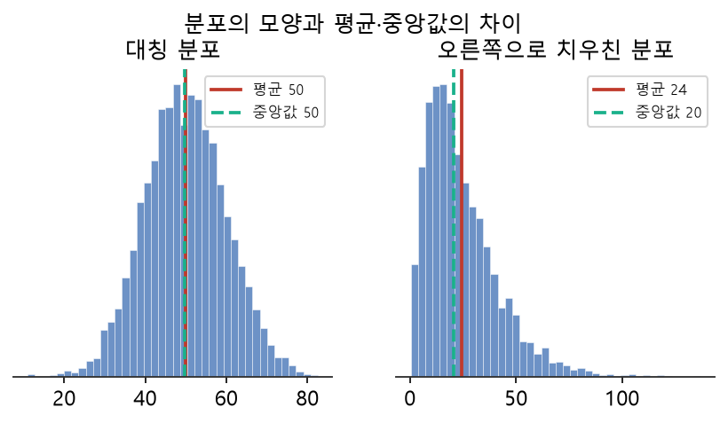
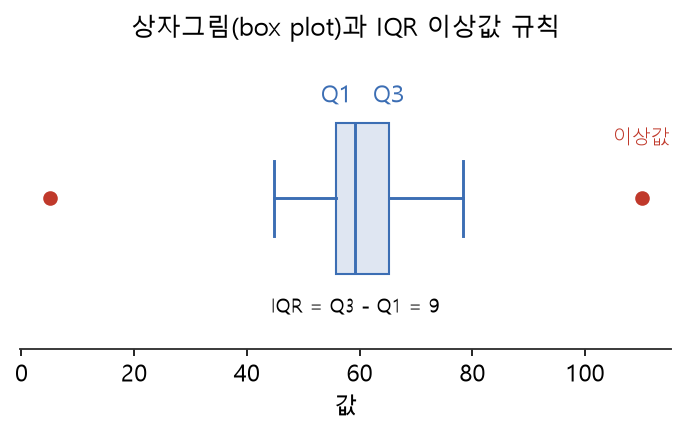

# 5주차 이론 — 탐색적 데이터 분석(EDA)과 품질 점검

## 데이터 진단과 탐색적 데이터 분석(EDA) {#sec-w5t-intro}

수집과 적재를 거쳐 저장소에 쌓인 원천 데이터(Raw Data)는 다양한 결함을 포함하고 있습니다. 센서 오류로 인한 결측, 잘못된 입력 서식, 비현실적인 극단값, 원천 시스템 간의 코드 불일치 등이 대표적입니다. 이러한 결함을 사전에 파악하지 않은 채 곧바로 가공이나 모델링에 들어가면, 잘못된 데이터로 인한 분석 오류가 발생하거나 정작 중요한 시스템 이상 신호를 놓치게 됩니다. 따라서 데이터를 정제하기에 앞서 데이터의 분포와 상태를 객관적으로 파악하는 진단 작업이 필요합니다. 이 과정을 **탐색적 데이터 분석(EDA, Exploratory Data Analysis)**이라고 합니다.

EDA는 1977년 통계학자 존 튜키(John Tukey)가 제안한 데이터 분석 접근법입니다. 튜키 이전의 통계학이 "수집된 데이터가 연구자의 사전 가설을 지지하는가"를 검증하는 확인적 분석에 치중했다면, 튜키는 가설을 세우기 전에 "데이터 자체가 어떤 분포와 특성을 보이는가"를 열린 시각으로 관찰해야 한다고 보았습니다. 데이터를 특정 모델이나 가설에 억지로 끼워 맞추기 전에, 데이터의 실제 구조와 이상 징후를 먼저 확인해야 한다는 뜻입니다.

데이터 파이프라인 관점에서 EDA는 곧 **품질 점검의 첫 단계**입니다. 구체적으로 다음과 같은 질문을 던지며 데이터를 진단합니다.

- **규모와 차원**: 전체 레코드 수와 속성(열)의 수는 얼마인가?
- **값의 분포**: 수치형 열의 중심 위치와 흩어진 정도는 어떠한가?
- **완전성(결측)**: 비어 있는 값(NULL)은 어느 열에 얼마나 존재하는가?
- **유효성(이상치)**: 업무 규칙이나 논리적 범위를 벗어난 이상값이 존재하는가?
- **변수 간 관계**: 열과 열 사이에 통계적 관련성이나 중복성이 존재하는가?

이러한 진단 결과는 데이터 정제(Cleaning) 작업의 기준과 명세서가 됩니다. 결측을 어떻게 채울지, 이상값을 제거할지 보정할지, 범주를 어떻게 표준화할지가 모두 EDA 결과에 따라 결정됩니다.

## 기술통계를 이용한 데이터 요약 {#sec-w5t-why}

수만 건에서 수백만 건에 이르는 데이터를 행 단위로 일일이 확인하는 것은 불가능합니다. 따라서 데이터의 전반적인 성격을 파악하려면 대량의 관측값을 소수의 대표 수치로 압축하는 **요약(summary)** 과정이 필수적입니다.

요약은 개별 데이터의 미시적인 세부사항을 버리는 대신, 집합 전체의 거시적인 패턴을 드러냅니다. 예를 들어 "환자 10,000명의 평균 연령이 48세"라는 단 한 줄의 수치는 만 개의 개별 값을 생략하지만, 대상 집단의 주요 연령층을 즉각 파악하게 해 줍니다. 

그러나 단일 통계량에만 의존하면 데이터의 왜곡을 놓치기 쉽습니다. 평균이 48세라 하더라도, 40대가 고르게 모여 있는 집단일 수도 있고 소아(10세 미만)와 고령층(80대)이 양극단으로 갈라진 집단일 수도 있습니다. 따라서 왜곡된 판단을 방지하려면 복수의 통계량과 시각화 도구를 병행하여 데이터를 다각도로 교차 점검해야 합니다.

## 수치형 데이터의 기술통계량과 분포 특성 {#sec-w5t-stats}

수치형 데이터의 분포 특성은 중심 위치(대표값), 흩어진 정도(산포), 비대칭성이나 이상값 유무를 나타내는 분포 형태로 구분하여 파악합니다.

```{mermaid}
%%| fig-cap: "그림 5-1. 수치형 기술통계 지표의 분류"
flowchart TB
    D["수치형 데이터"] --> C["중심 경향도<br/>(Center)"]
    D --> S["산포도<br/>(Spread)"]
    D --> H["분포 형태<br/>(Shape)"]
    C --> C1["평균 · 중앙값 · 최빈값"]
    S --> S1["범위 · 사분위범위(IQR) · 분산 · 표준편차"]
    H --> H1["왜도(치우침) · 첨도 · 다봉성 · 이상값"]
```

### 1. 중심 경향도 (Center)
데이터 값이 어느 위치를 중심으로 집중되는지를 나타냅니다.

- **평균(Mean)**: 모든 관측값의 합을 전체 개수로 나눈 값입니다. 수학적으로 다루기 쉬워 널리 쓰이지만, 극단적으로 크거나 작은 값(이상값)에 민감하게 반응하여 왜곡될 수 있습니다.
- **중앙값(Median)**: 데이터를 크기순으로 나열했을 때 한가운데 위치하는 값입니다. 순위 기반이므로 극단값의 영향을 거의 받지 않는 로버스트(Robust)한 지표입니다.
- **최빈값(Mode)**: 가장 빈번하게 등장하는 값으로, 범주형 데이터나 이산형 데이터의 중심을 파악할 때 유용합니다.

소득, 자산, 웹사이트 체류 시간처럼 극단적인 이상값이 존재하는 데이터에서는 평균보다 중앙값이 일반적인 관측치를 더 정확하게 대변합니다.

### 2. 산포도 (Spread)
데이터가 중심값 주변에 얼마나 넓게 흩어져 있는지를 측정합니다.

- **최솟값(Min)과 최댓값(Max), 범위(Range)**: 데이터가 위치하는 양 끝단을 나타내며, 단순하지만 이상값에 매우 취약합니다.
- **표준편차(Standard Deviation)**: 평균으로부터 각 관측값이 떨어진 거리의 평균적 척도입니다. 데이터의 변동성을 파악하는 표준 지표이지만, 평균과 마찬가지로 이상값의 영향을 받습니다.
- **사분위범위(IQR, Interquartile Range)**: 중앙 50%의 관측값이 차지하는 구간 폭($Q_3 - Q_1$)으로, 이상값에 강건한 산포 측도를 제공합니다.

평균이 동일한 두 집단이라도 산포도가 다르면 완전히 다른 특성을 가집니다. 예를 들어 두 지점의 월평균 매출이 5,000만 원으로 같더라도, 한 지점은 매달 4,800만~5,200만 원 사이를 안정적으로 유지하고 다른 지점은 1,000만 원과 9,000만 원을 오간다면 운영 리스크 관리는 전혀 달라져야 합니다.

### 3. 분포 형태 (Shape)
데이터가 대칭인지, 특정 방향으로 꼬리가 길게 늘어져 있는지를 나타냅니다.

{width=88%}

- **좌우 대칭 분포(Symmetric)**: 평균과 중앙값이 거의 일치하며, 중심을 기준으로 양쪽 꼬리의 감소 속도가 비슷합니다.
- **오른쪽 꼬리 분포(Right-skewed, 양의 왜도)**: 대다수 데이터가 왼쪽에 몰려 있고 소수의 매우 큰 값이 오른쪽에 존재합니다. 소수의 큰 값이 평균을 오른쪽으로 끌어당기므로 **평균 > 중앙값** 관계가 성립합니다. (예: 소득, 병원 진료비, 대기 시간)
- **왼쪽 꼬리 분포(Left-skewed, 음의 왜도)**: 대다수 데이터가 오른쪽에 몰려 있고 소수의 매우 작은 값이 왼쪽에 길게 늘어섭니다. 이 경우 **평균 < 중앙값**이 됩니다. (예: 대학교 졸업 이수 학점, 쉬운 시험의 성적 분포)

SQL에서는 집계 함수를 통해 이러한 요약 통계량을 산출합니다. `COUNT`, `AVG`, `MIN`, `MAX`, `SUM`을 활용하며, `GROUP BY` 절과 결합하여 세부 그룹별 분포를 비교합니다.

## 결측값(Missing Value)의 진단과 패턴 파악 {#sec-w5t-missing}

결측값은 데이터베이스 내에 특정 열의 값이 비어 있는 상태를 의미하며, 데이터의 **완전성(Completeness)**에 해당합니다. 관계형 데이터베이스에서는 이를 `NULL`로 처리하며, SQL 조건문 `WHERE 열 IS NULL`을 통해 조회합니다.

결측 진단에서 가장 중요한 것은 단순 결측 건수를 확인하는 데 그치지 않고, **결측의 발생 기저 메커니즘**을 파악하는 것입니다.

| 결측 유형 | 발생 메커니즘 | 실무 예시 | 진단 및 처리 시 주의점 |
|---|---|---|---|
| **완전 무작위 결측<br/>(MCAR)** | 결측 발생이 다른 변수나 해당 변수의 값과 무관하게 무작위로 발생 | 전송 중 일시적 패킷 손실, 단순 기록 누락 | 표본 크기 축소 외에는 편향(Bias)을 초래하지 않음 |
| **무작위 결측<br/>(MAR)** | 다른 관측 변수의 특성에 따라 결측률이 달라지지만, 해당 변수 자체 값과는 무관 | 남성보다 여성이 체중 기재를 누락하는 경향 (성별 변수로 설명 가능) | 성별 등 관련 변수를 통제한 후 대체(Imputation) 필요 |
| **비무작위 결측<br/>(MNAR)** | 결측된 변수 자체의 값에 의해 결측이 발생 | 고소득자가 소득 질문을 거부, 증상이 경미한 환자가 후속 검사를 건너뜀 | 결측 자체에 강한 편향이 포함되므로 단순 삭제 시 왜곡 심화 |

EDA 단계에서는 결측률이 높은 열을 식별하고, 특정 그룹(예: 지역, 연령대, 장비 모델)에 따라 결측이 편중되어 발생하는지(`GROUP BY` 집계) 교차 검증해야 합니다.

## 이상값(Outlier)의 유형과 판정 기준 {#sec-w5t-outlier}

이상값은 데이터 세트의 전반적인 분포 패턴에서 현저하게 벗어난 관측치를 의미합니다. 이상값은 발생 원인에 따라 크게 두 가지로 분류됩니다.

1. **오류 데이터(Error Data)**: 측정 장비 오작동, 입력 오류, 단위 표기 혼선으로 발생한 비정상 값입니다. (예: 나이 999세, 체온 -10℃). 이는 업무 규칙(Domain Logic) 기반의 유효 범위 검사로 즉시 필터링해야 합니다.
2. **자연 발생 극단치(Genuine Extreme Values)**: 실제로 발생한 현상이지만 발생 빈도가 극히 낮은 값입니다. (예: 초고소득자의 자산 규모, 금융 사기 거래, 희귀 질환 지표).

통계적으로 이상값을 정의하고 검출할 때 널리 쓰이는 표준 기법이 **사분위범위(IQR) 규칙**입니다.

$$
\mathrm{IQR} = Q_3 - Q_1, \qquad
\text{정상 범위} = \bigl[\,Q_1 - 1.5\,\mathrm{IQR},\;\; Q_3 + 1.5\,\mathrm{IQR}\,\bigr]
$$ {#eq-iqr}

::: {.eqnote}
- $Q_1$ (제1사분위수): 데이터를 오름차순 정렬했을 때 하위 25% 지점의 값
- $Q_3$ (제3사분위수): 데이터를 오름차순 정렬했을 때 상위 25% 지점의 값
- $\mathrm{IQR}$: 전체 데이터 중 중앙 50% 관측치가 차지하는 구간 폭
- 허용 한계선(Inner Fence): $Q_1 - 1.5\times\mathrm{IQR}$ 미만이거나 $Q_3 + 1.5\times\mathrm{IQR}$ 초과인 값을 이상값 후보로 규정합니다.
:::

{width=82%}

IQR 기반 규칙은 정규분포를 가정한 표준편차 방식($\mu \pm 3\sigma$)에 비해 이상값 자체에 의해 기준선이 왜곡되지 않는 장점이 있습니다. 상자그림(Box Plot)을 활용하면 이러한 이상값의 분포와 정상 데이터의 범위를 한눈에 파악할 수 있습니다.

이상값 판정 시 주의할 점은 **이상값을 기계적으로 삭제해서는 안 된다는 점**입니다. 금융 부정 거래 탐지(FDS)나 장애 감지 시스템에서는 이상값 자체가 탐지의 핵심 대상입니다. 따라서 EDA 단계에서는 이상값의 목록과 범위를 추출해 기록해 두고, 도메인 전문가와 협의하여 보정·대체·유지 여부를 결정해야 합니다.

## 변수 간 상관관계와 해석의 주의점 {#sec-w5t-corr}

단일 변수의 분포를 진단한 후에는 변수와 변수 사이의 통계적 관련성을 검토합니다. 두 수치형 변수가 함께 변화하는 선형적 경향성을 **상관관계(Correlation)**라고 합니다.

상관관계의 강도는 피어슨 상관계수($r$)로 측정하며, $-1$부터 $+1$ 사이의 값을 가집니다.

- $r \approx +1$: 한 변수가 증가할 때 다른 변수도 비례하여 증가하는 강한 양의 상관관계
- $r \approx -1$: 한 변수가 증가할 때 다른 변수는 감소하는 강한 음의 상관관계
- $r \approx 0$: 두 변수 사이에 뚜렷한 선형적 관계가 존재하지 않음

상관분석을 수행할 때 유의해야 할 두 가지 원칙이 있습니다.

1. **선형성 한계**: 피어슨 상관계수는 직선 관계만을 측정합니다. 두 변수가 $U$자형 곡선이나 원형 등 뚜렷한 비선형 관계를 가지더라도 상관계수는 $0$에 가깝게 계산될 수 있습니다. 따라서 산점도(Scatter Plot)를 통해 실제 관계의 형태를 시각적으로 확인해야 합니다.
2. **상관과 인과의 혼동 금지 (Correlation does not imply Causation)**: 두 변수 간에 높은 상관성이 관찰된다고 해서 한 변수가 다른 변수의 원인이 되는 것은 아닙니다. 제3의 교란 요인(Confounding Factor)에 의해 우연히 두 변수가 함께 움직이는 허위 상관(Spurious Correlation)일 가능성을 항상 배제해야 합니다.

## SQL 기반 데이터 프로파일링 기법 {#sec-w5t-profiling}

**데이터 프로파일링(Data Profiling)**은 앞서 살펴본 레코드 수, 결측치, 극단값, 데이터 타입의 유효성을 체계적인 요약표로 일괄 집계하는 실무 절차입니다. 대용량 데이터베이스를 다룰 때 데이터 전체를 로컬로 다운로드하지 않고, 데이터베이스 엔진 내에서 SQL 집계 함수를 실행하여 프로파일링 리포트를 생성합니다.

```sql
-- 열별 결측 건수, 유효값 범위, 평균 등을 일괄 진단하는 프로파일링 쿼리 예시
SELECT
  COUNT(*)                                            AS 전체_레코드수,
  SUM(CASE WHEN age IS NULL THEN 1 ELSE 0 END)        AS age_결측건수,
  ROUND(100.0 * SUM(age IS NULL) / COUNT(*), 2)       AS age_결측률_pct,
  MIN(age)                                            AS age_최솟값,
  MAX(age)                                            AS age_최댓값,
  ROUND(AVG(age), 1)                                  AS age_평균,
  COUNT(DISTINCT region)                              AS region_고유값수
FROM customers;
```

이와 같은 프로파일링 쿼리를 실행하면 다음과 같은 시스템적 이상을 즉시 감지할 수 있습니다.

- 결측률이 지나치게 높아(예: 80% 이상) 분석 피처로 활용하기 부적합한 열 식별
- 최솟값이나 최댓값이 유효 도메인을 벗어난 열 탐지 (예: `MIN(age) = -1`, `MAX(age) = 999`)
- 고유값 수가 $1$개뿐이어서 판별력이 전혀 없는 무의미한 상수 열 식별

## 데이터 규모와 구조적 특성 파악 {#sec-w5t-shape}

데이터 분석을 시작할 때 가장 먼저 확인해야 하는 기본 정보는 테이블의 물리적 규모와 스키마 구조입니다.

- **행(Row)의 수**: 수집된 데이터의 모수와 샘플 크기를 나타냅니다. 데이터 건수가 통계적 추론이나 머신러닝 모델 학습에 충분한지 검토합니다.
- **열(Column)의 수와 타입**: 각 속성이 정수형(`INTEGER`), 부동소수점(`FLOAT`), 문자형(`VARCHAR`), 날짜·시간형(`TIMESTAMP`) 중 올바른 타입으로 정의되어 있는지 확인합니다. 숫자로 저장되어야 할 값이 콤마(`,`)나 통화 기호 때문에 문자열로 적재된 경우를 이 단계에서 적발합니다.
- **단일값 열과 식별자 열**: 모든 행이 동일한 값을 갖는 열(Variance = 0)은 정보를 제공하지 못하므로 제거 후보가 됩니다. 반대로 모든 행의 값이 고유한 일련번호나 식별자(ID) 열은 엔티티 식별에는 필수적이지만, 모델링의 독립변수로는 배제해야 합니다.

## 범주형 데이터의 빈도와 카디널리티 {#sec-w5t-categorical}

수치형 데이터와 달리 연산이 불가능한 범주형(Categorical) 데이터는 **빈도 분석(Frequency Analysis)**을 중심으로 탐색합니다.

### 1. 빈도 분포와 최빈값
각 범주에 속한 데이터 건수와 전체 대비 비율을 계산합니다. SQL에서는 `GROUP BY`와 `COUNT(*)`로 쉽게 집계할 수 있습니다. 범주 간의 빈도 불균형이 극심한 경우(예: 정상 거래 99.9%, 부정 거래 0.1%), 머신러닝 모델 학습 시 클래스 불균형(Class Imbalance) 문제를 고려해야 합니다.

### 2. 카디널리티(Cardinality) 평가
카디널리티는 특정 열이 가질 수 있는 고유값(Distinct values)의 개수를 의미합니다.

- **낮은 카디널리티(Low Cardinality)**: 성별(2개), 결제수단(4~5개)처럼 범주의 종류가 적은 경우입니다. 원-핫 인코딩(One-Hot Encoding)이나 그룹별 집계가 수월합니다.
- **높은 카디널리티(High Cardinality)**: 고객 주소의 동/읍/면 단위, 직업 세분류처럼 수백~수천 개의 고유값을 갖는 경우입니다. 이를 그대로 범주형 변수로 변환하면 차원의 저주가 발생하므로, 상위 빈도 범주 외에는 '기타(Other)'로 묶거나 계층적 범주로 재분류하는 정제 전략을 수립해야 합니다.

또한 빈도 분석 과정에서 표기 불일치 문제("서울", "서울시", "서울특별시")나 오탈자("경기공", "경기도")를 발견하여 표준화 작업 항목으로 등록합니다.

## 시각화를 통한 분포 패턴 검증 {#sec-w5t-viz}

수치적 요약 통계량은 데이터의 형태를 압축하여 보여주지만, 분포의 왜곡이나 다봉성(Multimodality)을 숨길 수 있습니다.

대표적인 예가 **앤스컴 콰르텟(Anscombe's Quartet)**입니다. 평균, 표본분산, 상관계수, 회귀직선이 완전히 일치하는 네 개의 데이터 세트가 실제 산점도를 그렸을 때는 정규분포형, 곡선형, 단일 극단치형 등 완전히 상이한 구조를 드러냅니다.

- **히스토그램(Histogram)**: 연속형 수치 데이터를 일정한 구간(Bin)으로 나누어 빈도를 막대 높이로 표시합니다. 데이터가 단일 봉우리(Unimodal)를 이루는지, 복수의 봉우리(Bimodal)로 나뉘는지, 좌우 대칭인지를 직관적으로 파악할 수 있습니다.
- **상자그림(Box Plot)**: 사분위수와 이상값을 표준 규격으로 요약하여, 여러 집단 간의 중심 위치와 산포도 차이를 한 화면에서 병렬 비교할 때 가장 효과적입니다.

Python의 `matplotlib`과 `seaborn` 라이브러리를 활용하면 SQL 쿼리로 추출한 집계 데이터를 직관적인 시각 자료로 신속하게 전환할 수 있습니다.

## EDA 결과와 데이터 품질 지표의 연계 {#sec-w5t-quality-link}

EDA에서 수행하는 제반 진단 절차는 6대 데이터 품질 관리 지표와 1:1로 직접 대응됩니다.

| EDA 진단 작업 | 대응 품질 지표 | 진단 세부 내용 | 정제 조치 방향 |
|---|---|---|---|
| 결측치(NULL) 집계 | **완전성 (Completeness)** | 필수 입력 항목의 누락 여부 확인 | 기본값 대체, 보간법 적용, 행 삭제 |
| 허용 범위 및 서식 검사 | **유효성 (Validity)** | 나이 음수, 미래 날짜, 정규표현식 불일치 | 유효 범위 외 값 제거, 표준 포맷 변환 |
| 기본키(PK) 중복 검사 | **유일성 (Uniqueness)** | 동일 식별자 또는 동일 이벤트 중복 적재 | 중복 레코드 디둡(Deduplication) |
| 변수 간 논리 관계 검사 | **일관성 (Consistency)** | 생년월일과 나이 불일치, 퇴실이 입실보다 빠른 경우 | 상충 데이터 보정 또는 플래그 처리 |
| 범주 빈도 및 쏠림 분석 | **다양성 (Diversity)** | 특정 클래스 과대/과소 대표 여부 확인 | 리샘플링, 계층 추출, 데이터 추가 수집 |
| 외부 참조 데이터 대조 | **정확성 (Accuracy)** | 실제 주소 체계나 사업자등록번호 유효성 대조 | 마스터 데이터와 조인하여 오류 교정 |

이와 같이 EDA는 품질 지표를 정량적으로 측정하는 실무 도구이며, 진단 결과 도출된 수치는 정제 작업의 우선순위를 결정하는 정량적 근거가 됩니다.

## SQL과 Python의 역할 분담 {#sec-w5t-tools}

실무 파이프라인에서 EDA는 SQL과 Python의 상호 보완적 조합으로 수행됩니다.

- **데이터베이스 엔진 (SQL)**:
  - 수천만 건 이상의 대용량 테이블에 직접 접근하여 필터링, 그룹 집계(`GROUP BY`), 카운트 연산을 고속으로 수행합니다.
  - 네트워크 대역폭과 로컬 메모리 자원을 절약하기 위해, 원천 데이터 전체를 추출하지 않고 1차 요약 통계량만을 산출하는 역할을 담당합니다.
- **분석 환경 (Python / Pandas / Visualization)**:
  - SQL로 요약되거나 샘플링된 데이터를 전달받아 세밀한 통계 검정, 사분위수 계산, 상관행렬 히트맵, 상자그림 등 복합 시각화를 생성합니다.
  - 자동화된 데이터 프로파일링 라이브러리(`ydata-profiling` 등)를 적용하여 심층 리포트를 생성할 수 있습니다.

EDA 단계에서는 이 두 도구의 경계를 명확히 인지하고, "대규모 데이터의 1차 진단과 필터링은 SQL에서, 정밀 분석과 다변량 시각화는 Python에서" 수행하는 역할 분담 원칙을 따릅니다.

## 데이터 진단 보고서 작성과 정제 명세서 도출 {#sec-w5t-record}

EDA의 최종 산출물은 단순한 개인의 분석 메모가 아닌, 공식적인 **데이터 품질 진단 보고서(Data Quality Assessment Report)** 형태로 정리되어야 합니다.

진단 보고서에는 다음 항목이 표준적으로 포함됩니다.

1. **데이터 개요**: 원천 데이터 소스, 수집 기간, 전체 레코드 수 및 열 목록
2. **품질 결함 상세**:
   - 열별 결측 건수 및 결측률 (%)
   - 발견된 이상값 목록 및 판단 근거 (업무 규칙 위반 또는 IQR 초과)
   - 범주형 데이터의 표기 불일치 및 고유값 목록
3. **정제 조치 계획(Data Cleaning Specification)**:
   - 각 결함 항목에 대한 구체적 처리 방안 (예: "결측치 5% 미만인 열은 중앙값으로 대체", "나이 100 초과 3건은 NULL 처리 후 제거")

진단 결과를 이처럼 구조화된 문서로 남겨야 데이터 파이프라인의 변경 이력이 보존되고, 정제 작업의 정당성을 데이터 엔지니어 및 분석가 간에 투명하게 공유할 수 있습니다. EDA는 데이터를 정제하기 전 데이터의 현주소를 객관적 지표로 확정하는 필수적인 엔지니어링 과정입니다.

