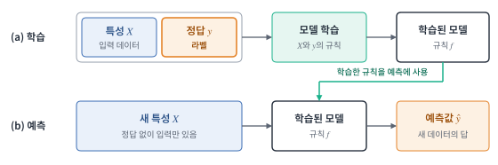
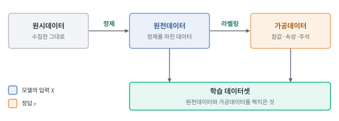
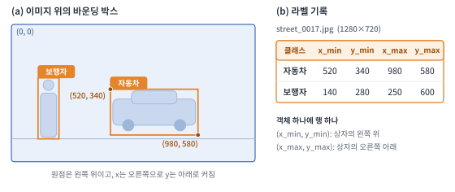
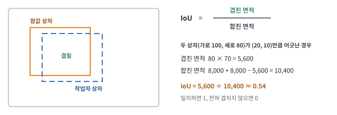
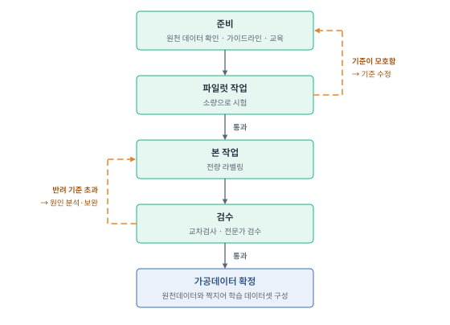
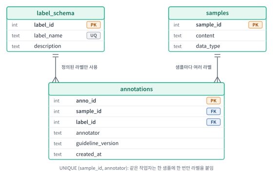

# 9주차 이론 — 학습데이터 구축과 라벨링의 개념

## 지도학습과 라벨링 {#sec-w9t-intro}

지도학습(supervised learning)은 입력과 정답을 짝지어 보여 주며 둘 사이의 규칙을 배웁니다. 학습에는 깨끗한 데이터만이 아니라, 각 데이터가 가리켜야 할 **정답**이 필요합니다. 수집과 정제를 마친 데이터에는 아직 그 정답이 없습니다.

@fig-w9-sup 은 이 구조를 보여 줍니다. 학습 단계에서는 특성 $X$와 정답 $y$를 함께 주어 모델이 규칙을 배우고, 예측 단계에서는 새 특성만 주어 정답을 예측합니다. 정답 $y$가 없으면 학습이 시작되지 않습니다.

{#fig-w9-sup width=100% fig-alt="학습 단계에서는 특성과 정답이 모델 학습으로 들어가 학습된 모델이 되고, 예측 단계에서는 새 특성이 학습된 모델을 거쳐 예측값이 된다."}

**라벨링(labeling)**은 데이터에 모델이 학습할 수 있는 정답과 설명 정보를 붙이는 작업입니다. 이미지·텍스트·음성·시계열 같은 원천 데이터가 무엇을 뜻하는지를 사람의 판단으로 표시해 데이터로 남기는 일입니다. 정제가 잘못된 값을 바로잡아 데이터를 쓸 수 있게 만든다면, 라벨링은 데이터에 없던 정보를 새로 부여합니다. 라벨링의 결과가 **라벨**이고, 위치·구간·속성·주석까지 포함한 것을 **어노테이션(annotation)**이라고 합니다. 비슷한 말이 여러 개 쓰이므로 구분해 둡니다.

| 용어 | 뜻 | 예 |
|---|---|---|
| 라벨(label) | 데이터 하나에 붙이는 정답 | 리뷰 → 긍정 |
| 어노테이션(annotation) | 라벨에 위치·구간·속성·주석까지 포함한 부가 정보 전체 | 사진 속 자동차의 사각형 좌표와 클래스 |
| 참값(Ground Truth) | 모델이 정답으로 삼는 기준 값 | 전문가가 확정한 진단 |
| 가공데이터 | 원천 데이터에 참값과 속성·주석을 붙인 결과 | 이미지 한 장당 JSON 파일 하나 |

: 라벨링 관련 용어 {#tbl-w9-terms}

참값은 절대적인 진실이 아니라 **합의된 기준**입니다. 진단처럼 정답이 분명한 과제에서는 전문가의 확정이 곧 참값입니다. 그러나 감정이나 비꼼처럼 해석이 갈리는 과제에서는 여러 작업자의 판단을 모아 기준을 정합니다. 따라서 참값을 어떻게 정했는지도 데이터와 함께 남겨야 합니다.

가공데이터는 보통 JSON 같은 형식으로 저장하며, 원천 데이터의 식별자와 라벨, 작업 정보를 함께 담습니다.

```json
{
  "sample_id": 17,
  "content": "배달이 빨라요",
  "annotation": {
    "label": "긍정",
    "annotator": "A03",
    "guideline_version": "v1.1"
  }
}
```

필수 키가 빠지거나 값의 형식이 다르면 구조의 오류이고, 형식이 맞아도 라벨이 틀리면 내용의 오류입니다. 이 둘은 검사 방법이 다르며, 뒤에서 구분해 다룹니다.

라벨링은 정제 다음 단계입니다(@fig-w9-stages). 정제를 마친 원천데이터에 라벨을 붙여 가공데이터를 만들고, 두 데이터를 짝지어 학습 데이터셋으로 씁니다.

{#fig-w9-stages width=100% fig-alt="원시데이터를 정제해 원천데이터를 만들고, 라벨링해 가공데이터를 만든 뒤, 원천데이터와 가공데이터를 짝지어 학습 데이터셋을 구성한다."}

정답 없이 구조를 찾는 군집화나 라벨 없이 사전학습하는 방식에서는 가공 단계를 생략하기도 합니다. 그러나 분류·검출처럼 지도학습으로 푸는 문제에서는 라벨의 품질이 곧 학습 데이터의 품질입니다.

## 라벨 오류의 영향 {#sec-w9t-quality}

라벨은 모델이 따라 배우는 기준인 동시에 모델을 평가하는 기준입니다. 같은 오류도 어디에 들어 있느냐에 따라 치르는 비용이 다릅니다.

| 오류가 있는 곳 | 생기는 일 | 확인된 사례 |
|---|---|---|
| 학습용 라벨 | 무작위 오류는 어느 정도 견디지만, 오류가 많을수록 같은 성능에 더 많은 데이터가 필요함 | MNIST에서 정답 예시 하나에 무작위 라벨 예시 100개를 섞어도 정확도 90% 이상이 나왔으나, 데이터를 크게 늘려야 했음 |
| 평가용 라벨 | 모델의 성능과 순위가 왜곡됨 | 널리 쓰이는 10개 테스트셋의 평균 라벨 오류는 최소 3.3%, ImageNet 검증셋은 최소 6%. 정정한 라벨로 평가하면 오류 라벨이 6%만 늘어도 ResNet-18이 ResNet-50을 앞섬 |
| 서비스 단계 | 문제가 늦게 드러나고 후속 작업에 누적됨 | 데이터 문제가 이후 단계로 번지며 쌓이는 현상을 데이터 캐스케이드라고 함 |

: 라벨 오류가 비용이 되는 곳 {#tbl-w9-cost}

학습 라벨의 오류가 항상 모델을 망치는 것은 아닙니다. 그러나 그 오류를 견디려면 더 많은 데이터가 필요하고, 평가 라벨의 오류는 어떤 모델이 더 좋은지 판단하는 기준 자체를 흔듭니다.

라벨 오류는 눈에 잘 띄지 않는 것도 문제입니다. 결측이나 형식 오류는 EDA와 SQL로 찾을 수 있지만, 라벨이 맞는지는 그 분야를 아는 사람이 보거나 다른 기준과 대조해야 알 수 있습니다. 그래서 모델 구조를 바꾸기 전에 데이터와 라벨을 먼저 개선하는 데이터 중심 접근이 쓰입니다.

## 라벨링 작업의 종류와 정밀도 {#sec-w9t-types}

라벨링은 데이터의 종류와 풀려는 문제에 따라 형태가 달라집니다.

| 종류 | 답하는 질문 | 결과의 모양 | 예 |
|---|---|---|---|
| 분류 | 이것은 무엇인가 | 범주 하나(또는 여러 개) | 리뷰 → 긍정, 메일 → 스팸 |
| 검출 | 무엇이 어디에 있는가 | 사각형(바운딩 박스)과 클래스 | 사진 속 자동차의 위치 |
| 분할 | 경계가 정확히 어디까지인가 | 픽셀 영역. 시맨틱 분할은 같은 범주의 객체를 구별하지 않고, 인스턴스 분할은 객체별로 구분함 | 도로, 인도, 보행자 |
| 구간·개체 표시 | 텍스트나 시간의 어느 구간인가 | 시작·끝 위치와 범주 | '서울' → 지명 |
| 값·순위 | 얼마나, 어느 쪽이 더 나은가 | 숫자, 순서, 선호 쌍 | 별점, 응답 두 개 중 선호 |
| 전사·생성 | 어떻게 적는가 | 문장 | 이미지 캡션, 음성 전사 |
| 관계 | 둘이 어떻게 연결되는가 | 쌍과 관계 | 인물 — 소속 |

: 라벨링의 종류 {#tbl-w9-types}

형태는 임무에서 정해집니다. "무엇이 있는가"만 알면 되면 분류로 충분하고, 위치까지 필요하면 검출, 경계까지 필요하면 분할입니다. 정밀할수록 작업 시간과 검수 비용이 커지므로 목적에 필요한 만큼만 정밀하게 정합니다.

분류에는 두 방식이 있습니다. 샘플마다 라벨을 하나만 고르면 단일 라벨 분류이고, 여러 라벨을 동시에 붙일 수 있으면 다중 라벨 분류입니다. 뉴스 기사를 `경제` 하나로 분류하면 전자이고, `경제`와 `정치`를 함께 붙이면 후자입니다. 어느 쪽인지에 따라 라벨 체계와 저장 구조의 제약이 달라집니다.

형태가 같아도 데이터의 유형에 따라 미리 정해야 할 기준이 다릅니다.

| 데이터 유형 | 미리 정할 기준 | 예 |
|---|---|---|
| 이미지 | 분류 체계의 일관성, 객체를 세는 단위, 사각형의 여백 | 사각형은 대상 전체를 감싸고 여백은 최소로 |
| 비디오 | 프레임이 바뀌어도 같은 객체에 같은 식별자를 유지 | 걸어가는 사람은 모든 프레임에서 같은 번호 |
| 텍스트 | 라벨링 단위(문서·문장·토큰), 구간의 경계 | 기관명에 조사를 포함할지 여부 |
| 오디오 | 전사 기준, 텍스트와 소리의 시간 정렬 | 표준 발음과 다르게 말한 경우 발음 전사와 철자 전사를 함께 적음 |

: 데이터 유형별로 미리 정할 기준 {#tbl-w9-modality}

이미지에서 객체를 찾는 검출을 예로 라벨 한 건의 모습을 보겠습니다. 거리 사진에서 자동차와 보행자를 찾는 모델을 만든다면, 작업자는 대상마다 그것을 감싸는 사각형을 그리고 클래스를 고릅니다. 사각형은 왼쪽 위 꼭짓점과 오른쪽 아래 꼭짓점의 픽셀 좌표로 기록하고, 이미지 한 장에 객체가 여러 개이면 객체마다 한 건씩 기록합니다(@fig-w9-detect).

{#fig-w9-detect width=100% fig-alt="1280×720 거리 사진에서 자동차와 보행자를 각각 사각형으로 감싸고, 두 사각형의 클래스와 좌표를 객체당 한 행씩 표로 기록한다."}

같은 사각형도 기록 형식이 여럿입니다. 두 꼭짓점으로 쓰는 방식, 왼쪽 위 꼭짓점과 가로·세로 길이로 쓰는 방식, 중심 좌표와 가로·세로를 이미지 크기로 나누어 0에서 1 사이 값으로 쓰는 방식이 있습니다.

| 형식 | 기록하는 값 | 위 그림의 자동차 |
|---|---|---|
| 두 꼭짓점 (Pascal VOC) | x_min, y_min, x_max, y_max | 520, 340, 980, 580 |
| 왼쪽 위 + 크기 (COCO) | x_min, y_min, 가로, 세로 | 520, 340, 460, 240 |
| 중심 + 크기, 0~1로 나눈 값 (YOLO) | 중심 x, 중심 y, 가로, 세로 | 0.586, 0.639, 0.359, 0.333 |

: 사각형의 기록 형식 {#tbl-w9-bbox}

숫자 네 개만 보아서는 어느 형식인지 알 수 없습니다. 형식이 다른 데이터를 그대로 합치면 사각형이 엉뚱한 곳에 그려지므로, 가이드라인과 저장 구조에 좌표 형식과 원점의 위치를 명시합니다. 가이드라인에는 사각형을 그리는 규칙도 정해 둡니다. 다른 물체에 가려진 객체는 보이는 부분만 감쌀지 가려진 부분까지 추정해 감쌀지, 이미지 가장자리에서 잘린 객체도 라벨링할지, 몇 픽셀보다 작은 객체는 제외할지를 정하지 않으면 작업자마다 다르게 그립니다.

검출 라벨의 검수에서는 두 사각형이 얼마나 겹치는지를 IoU(Intersection over Union)로 재는 것이 일반적입니다. IoU는 겹친 면적을 두 사각형을 합친 면적으로 나눈 값으로, 완전히 일치하면 1이고 전혀 겹치지 않으면 0입니다(@fig-w9-iou). 작업자의 사각형을 골든 데이터셋의 사각형과 비교하거나 두 작업자의 사각형끼리 비교해 일치도로 씁니다. 몇 이상이면 통과로 볼지는 과제가 요구하는 정밀도에 맞추어 정합니다.

{#fig-w9-iou width=92% fig-alt="참값 상자와 작업자 상자가 일부 겹친 그림과, 겹친 면적을 합친 면적으로 나누는 IoU 계산식."}

## 라벨 체계의 설계 {#sec-w9t-taxonomy}

**라벨 체계(taxonomy)**는 사용할 라벨의 목록과 각 라벨의 정의입니다. 감정 분류라면 긍정·부정 둘로 할지, 중립을 넣을지, 5단계로 나눌지를 정하는 일이 여기에 해당합니다.

- 라벨이 서로 겹치지 않고(상호 배타), 가능한 모든 경우를 덮어야(전체 포괄) 합니다. 이를 MECE 원칙이라고 합니다.
- 작업자가 일관되게 구분할 수 있는 수준까지만 나눕니다.
- 어느 라벨에도 맞지 않는 경우를 위해 `기타`나 `판단 불가`를 둡니다.
- 라벨의 정의는 작업자가 읽고 바로 판단할 수 있는 말로 씁니다.
- 널리 쓰이는 표준 분류체계가 있으면 재사용하고, 대분류·소분류의 계층 구조로 설계하면 세분화 정도와 일관성을 함께 조절하기 쉽습니다.

| 라벨 수 | 얻는 것 | 잃는 것 |
|---|---|---|
| 2개(긍정·부정) | 판단이 단순해 일관성이 높음 | 중립이나 혼합된 의견을 담지 못해 억지로 분류하게 됨 |
| 3개(긍정·중립·부정) | 중립을 허용함 | 판단이 어려운 경우가 모두 중립으로 몰릴 수 있음 |
| 5단계 | 강도 정보를 얻음 | 이웃한 단계를 작업자마다 다르게 구분해 일치도가 떨어짐 |

: 감정 분류에서 라벨 수에 따른 득실 {#tbl-w9-taxonomy}

라벨 체계는 "이 라벨로 학습한 모델이 무엇을 해야 하는가"에서 출발합니다. 작업 도중에 체계를 바꾸면 이미 붙인 라벨을 다시 확인해야 하므로, 본 작업 전에 소량으로 시험하고 변경이 생기면 버전을 남깁니다.

## 라벨링 가이드라인 {#sec-w9t-guideline}

같은 리뷰를 보고 한 사람은 긍정, 다른 사람은 중립이라고 할 수 있습니다. 이런 불일치를 그대로 두면 모델은 서로 모순되는 정답을 함께 배웁니다. 이를 막는 도구가 **라벨링 가이드라인(annotation guideline)**입니다. 무엇을 어떤 기준으로 어떻게 표시할지를 문서로 정해 둔 작업 기준입니다.

| 구성 | 담는 내용 | 예 |
|---|---|---|
| 목적과 대상 | 어떤 모델·용도를 위한 라벨인지, 라벨링할 대상 | 음식점 리뷰의 전체 감정 |
| 라벨 정의 | 각 라벨의 뜻과 판단 기준 | 긍정: 만족이나 재방문·추천 의사가 중심 |
| 예시와 반례 | 대표 사례와 비슷하지만 해당하지 않는 사례 | "배달이 빨라요" → 긍정, "배달 왔어요" → 판단 불가 |
| 경계·모호·예외 사례 | 판단이 갈리는 경우의 규칙, 판단 불가 처리 | 칭찬과 불만이 반반이면 혼합 라벨 |
| 기록 형식 | 어노테이션 포맷, 필수 항목, 허용 값 | JSON 키 이름, 라벨 코드 목록 |
| 통과·반려 기준 | 어떤 결과를 합격시키고 어떤 결과를 재작업시킬지 | 라벨 누락, 정의되지 않은 값 |
| 변경 이력 | 버전과 변경 사유, 적용 시점 | v1.1: 혼합 라벨 추가 |

: 라벨링 가이드라인의 구성 {#tbl-w9-guideline}

가이드라인의 품질은 **경계 사례**를 얼마나 촘촘히 다루었는지에서 갈립니다. 명확한 경우는 누가 보아도 판단이 같고, 판단이 갈리는 곳은 애매한 경우입니다. 얼굴이 반쯤 가려진 사진을 얼굴로 볼지, 칭찬과 불만이 섞인 리뷰를 어떻게 볼지를 미리 정해 두어야 합니다.

가이드라인이 불완전하거나 지켜지지 않으면 작업자마다 다르게 처리해 일관성이 깨집니다. 검수에서 발견한 오류는 유형과 원인을 모아 가이드라인과 작업자 교육에 반영합니다. 이렇게 반영하지 않으면 같은 오류가 반복됩니다.

## 라벨링 작업의 흐름 {#sec-w9t-workflow}

대규모 라벨링은 한 번에 끝내지 않고 소량으로 시험하며 기준을 고치는 순환으로 진행합니다(@fig-w9-flow).

{#fig-w9-flow width=88% fig-alt="준비, 파일럿 작업, 본 작업, 검수, 가공데이터 확정의 순서로 진행하며, 파일럿과 검수에서 기준을 고치는 되돌림 경로가 있다."}

**파일럿**이 중요한 이유는 모호한 규칙의 비용에 있습니다. 규칙의 빈틈을 본 작업 뒤에 발견하면 수천 건에 퍼진 오류를 다시 고쳐야 하지만, 소량으로 먼저 작업하면 입력 오류와 빈틈을 적은 비용으로 찾습니다. 주석 개발에서는 이 순환을 더 넓게 봅니다. 규칙을 세우고, 소량에 주석을 달고, 그 결과로 모델을 학습·시험해 어디서 틀리는지 확인한 뒤 규칙을 고치는 과정을 반복합니다. 모델이 틀리는 곳에서 규칙의 빈틈이 드러나기도 하기 때문입니다.

## 작업자와 품질 관리 {#sec-w9t-workers}

데이터의 성격과 목적에 따라 작업자를 구성하는 방식이 달라집니다.

| 구성 방식 | 알맞은 작업 | 주의할 점 |
|---|---|---|
| 크라우드소싱 | 단순 반복 작업, 대량 작업, 개인정보·기밀 수준이 낮은 데이터 | 작업자별 편차가 큼. 가이드라인으로 편차를 줄이고 교차검사와 전문가 검토를 둠 |
| 전문 인력 위탁 | 의료·법률처럼 전문 지식과 숙련이 필요한 작업 | 전문성 차이로 표현과 이해가 어긋날 수 있음. 검수자와 작업자 사이의 피드백 구조를 분명히 함 |
| 내부 조직 | 모델 학습에 대한 이해가 필요하고 긴밀한 피드백이 필요한 작업 | 다른 조직과의 연계와 피드백 방법을 정함 |

: 작업자 구성 방식 {#tbl-w9-workers}

비전문가 여러 명의 라벨이 전문가 못지않을 수 있다는 근거도 있습니다. 감정 인식 등 단순한 언어 과제 여러 개를 합쳐 보니, 평균 4개의 비전문가 라벨이 전문가 한 명의 일치도와 비슷했습니다. 같은 샘플에 여러 명이 라벨을 달면 품질을 확보할 수 있다는 뜻입니다. 다만 2008년의 단순 과제에서 나온 결과이므로, 전문 지식이 필요한 과제에는 그대로 적용하지 못합니다.

**골든 데이터셋(golden dataset)**은 정답이 확정된 기준 데이터입니다. 전문가가 정답을 미리 검증해 둔 엄선된 데이터로, 일반적으로 여러 전문가가 독립적으로 라벨링한 뒤 불일치를 판정해 만듭니다. 비용이 크므로 필요한 범위에서만 구축합니다. 같은 개념을 가리키는 이름이 여럿입니다.

| 용어 | 주로 쓰이는 곳 |
|---|---|
| 골든 데이터셋, 골든셋(골든 세트), 골든 데이터 | 라벨링·AI 평가 현장 |
| 골드 스탠더드(gold standard) | 학술 자료 |
| 정답 데이터, 정답셋 | 구축 사업 문서 |

: 골든 데이터셋을 가리키는 용어 {#tbl-w9-golden}

한 샘플의 정답이 참값이라면, 참값을 모아 기준으로 삼는 집합이 골든 데이터셋입니다. 비전문가의 다수결로 얻은 합의 라벨이나 도구·모델이 만든 라벨은 전문가의 검증을 거치지 않았다면 골든 데이터셋과 구분하고 신뢰도를 낮게 봅니다. 이런 라벨을 실버(silver)라고 부르기도 합니다. 데이터 거버넌스에서도 골든 데이터라는 표현을 쓰지만, 그 뜻은 데이터 팀이 정확하고 최신이라고 인증한 고품질 데이터이므로 라벨링의 골든 데이터셋과 구분합니다.

골든 데이터셋은 세 곳에 쓰입니다.

- 함정 문제: 골든 데이터셋의 문항(통제 문항)을 작업 중에 섞어 작업자의 응답을 자동으로 확인합니다. 100문항 중 95문항이 정답과 일치하면 그 작업자의 정확도는 95%입니다.
- 의미 정확성 검사: 작업 결과를 골든 데이터셋과 비교해 정확도를 계산합니다.
- 평가: 모델의 성능을 평가하고 모델끼리 비교하는 기준으로 씁니다.

평가용 골든 데이터셋이 학습 데이터에 섞이면 평가가 왜곡되므로 분리합니다. 함정 문제를 오래 바꾸지 않으면 작업자가 정답을 알아맞힐 수 있으므로 문항을 추가하거나 갱신합니다. 또 함정 문제의 정답률이 높아도 작업이 부실할 수 있으므로, 작업자 사이의 일치도 같은 일관성 지표를 함께 봅니다.

작업 품질은 다음 장치로 지킵니다.

| 장치 | 방법 | 얻는 것 |
|---|---|---|
| 선별과 교육 | 선별 시험, 연습 데이터로 훈련, 합격한 작업자만 투입 | 시작 수준을 맞춤 |
| 함정 문제 | 정답을 아는 데이터를 작업 중에 섞어 정확도를 확인하고, 기준 미달이면 권한을 조정 | 작업 중 품질 저하를 일찍 발견 |
| 다단계 검수 | 작업자 자가검사 → 교차검사 → 전문가 검수 | 오류 유형을 파악하고 재작업을 지시 |
| 전수·표본 검사 | 형식은 전수로, 의미는 표본이나 점수 평가로 | 검수 비용과 정확도를 균형 있게 맞춤 |
| 오류 사례집 | 반복되는 오류를 모아 교육 자료와 가이드라인에 반영 | 같은 오류의 재발 방지 |

: 라벨링 품질 관리 장치 {#tbl-w9-qc}

라벨 오류는 유형에 따라 검사 방법이 다릅니다.

| 유형 | 내용 | 예 | 검사 방법 |
|---|---|---|---|
| 누락(미태깅) | 붙여야 할 라벨이 없음 | 사진 속 자동차 한 대에 사각형이 없음 | 라벨이 없는 샘플·객체를 쿼리나 자동 검사로 탐지 |
| 오분류(오태깅) | 다른 라벨을 붙임 | 부정 리뷰에 긍정 | 골든 데이터셋과 비교, 사람의 검수 |
| 경계·위치 오류 | 범주는 맞지만 위치나 구간이 어긋남 | 사각형이 대상의 절반만 감쌈 | 표본 검수, 겹침 비율·범위 검사 |
| 형식 오류 | 허용되지 않은 값이나 구조 | 정의되지 않은 라벨 코드, 필수 키 누락 | 제약 조건과 자동 검사 |
| 일관성 오류 | 같은 대상에 다른 기준을 적용 | 작업자에 따라 `기타`의 사용이 다름 | 작업자별 분포 비교, 가이드라인 보완 |

: 라벨 오류의 유형과 검사 방법 {#tbl-w9-errtype}

누락과 형식 오류는 대체로 구문 정확성의 문제이고, 오분류와 경계 오류는 의미 정확성의 문제입니다. 검사 기준은 **구문 정확성**과 **의미 정확성**으로 나눕니다. 이 구분은 어떤 검사를 기계에 맡기고 어떤 검사를 사람에게 맡길지 정해 줍니다.

| 구분 | 확인하는 것 | 주된 방법 |
|---|---|---|
| 구문 정확성 | 구조·형식·값의 범위가 설계대로인가, 누락된 정보는 없는가 | 자동 검사(SQL 제약, 쿼리) |
| 의미 정확성 | 라벨이 정답과 일치하고 맥락에 맞는가 | 사람의 검수, 정답 데이터와 비교 |

: 구문 정확성과 의미 정확성 {#tbl-w9-accuracy}

검사 기준은 수치로 미리 정합니다. 예를 들어 라벨이 빠진 비율(미태깅률)은 3% 이하, 잘못 붙은 비율(오태깅률)은 1% 이하, 어노테이션 형식의 정합률은 99% 이상처럼 정해 두고 전수 검사로 확인하는 방식이 쓰입니다. 데이터베이스의 `NOT NULL`, `CHECK`, `FOREIGN KEY`는 구문 정확성의 일부를 막아 주지만, 라벨이 의미상 맞는지는 막아 주지 못합니다.

## 라벨 불일치와 최종 라벨의 결정 {#sec-w9t-truth}

감정이 긍정인지 중립인지, 문장이 비꼬는 말인지, 표정이 기쁨인지 놀람인지는 사람마다 다르게 볼 수 있습니다. 판단이 어려운 선호 비교 과제에서는 선별 시험으로 뽑고 지침을 준 약 40명의 라벨러끼리도 일치율이 72.6%였고, 선별하지 않은 다른 라벨러 집단은 77.3%였습니다. 훈련을 받아도 판단이 갈립니다.

**일치율**은 불일치를 재는 가장 단순한 척도입니다. 두 작업자가 같은 샘플 10건에 라벨을 붙여 8건이 같으면 단순 일치율은 80%입니다. 다만 라벨이 두 가지뿐이면 무작위로 골라도 절반쯤은 일치하므로 일치율만으로 신뢰도를 판단해서는 안 됩니다. 우연히 일치하는 몫을 보정하는 지표(코헨의 카파 등)가 따로 있습니다.

불일치는 작업자의 실수일 수도 있지만, 기준이나 데이터의 문제를 알려 주는 신호일 때가 많습니다.

| 불일치의 원인 | 뜻 | 대응 |
|---|---|---|
| 작업자 실수·피로 | 한 사람이 틀림 | 재교육, 검수 |
| 가이드라인의 모호함 | 기준이 없어 판단이 갈림 | 기준 보완, 경계 사례 추가 |
| 데이터 자체의 모호함 | 사진이 흐리거나 문장이 중의적임 | 판단 불가로 처리하거나 제외 |
| 정당한 시각의 차이 | 주관적인 과제에서 관점이 다름 | 불일치의 분포를 보존 |

: 불일치의 원인과 대응 {#tbl-w9-disagree}

여러 작업자의 라벨에서 최종 라벨을 정하는 방법을 비교합니다.

| 방법 | 방식 | 장점 | 한계 |
|---|---|---|---|
| 다수결 | 가장 많은 라벨을 채택 | 단순하고 개별 실수를 상쇄함 | 다수가 틀릴 수 있고, 소수의 관점이 사라짐 |
| 전문가 판정 | 불일치한 건을 전문가가 결정 | 정확하고 근거가 남음 | 비용과 시간이 듦 |
| 불일치 보존 | 작업자별 라벨을 모두 저장하고 분포(긍정 60%, 부정 40%)를 활용 | 모호함의 정보를 유지함 | 저장과 학습 방법이 복잡해짐 |
| 제외·보류 | 합의되지 않은 데이터를 제외 | 평가용 데이터를 깨끗하게 유지 | 어려운 사례가 빠져 편향됨 |

: 최종 라벨을 정하는 방법 {#tbl-w9-final}

일부 주관적인 과제에서는 라벨을 하나로 합치기 전에 작업자별 관점을 유지하며 학습한 모델이, 합친 라벨로 학습한 모델과 같거나 더 나은 성능을 보였습니다. 라벨 변이는 데이터, 모델, 평가 전 과정에 영향을 주므로, 합치기 전의 원래 라벨을 남겨 두어야 나중에 어떤 방법으로든 다시 처리할 수 있습니다. 저장 구조는 이 요구에서 나옵니다.

## 라벨 데이터의 저장 구조 {#sec-w9t-schema}

원본 데이터(샘플), 라벨 체계, 어노테이션을 서로 다른 테이블로 나누어 저장합니다(@fig-w9-schema).

{#fig-w9-schema width=100% fig-alt="label_schema와 samples 테이블이 각각 annotations 테이블과 일대다로 연결된다."}

| 테이블 | 담는 내용 | 키와 제약 |
|---|---|---|
| `samples` | 라벨을 붙일 원본(문장, 이미지 경로 등) | 기본 키 `sample_id` |
| `label_schema` | 허용되는 라벨의 목록과 정의 | 기본 키 `label_id`, `label_name`은 중복 불가 |
| `annotations` | 어떤 샘플에 어떤 라벨을 누가 언제 어떤 기준으로 붙였는가 | 외래 키 두 개, 같은 작업자가 같은 샘플에 두 번 붙이지 못하도록 `UNIQUE(sample_id, annotator)` |

: 라벨 저장 테이블의 구성 {#tbl-w9-schema}

```sql
CREATE TABLE annotations(
  anno_id           INTEGER PRIMARY KEY AUTOINCREMENT,
  sample_id         INTEGER NOT NULL REFERENCES samples(sample_id),
  label_id          INTEGER NOT NULL REFERENCES label_schema(label_id),
  annotator         TEXT NOT NULL,
  guideline_version TEXT NOT NULL,
  created_at        TEXT NOT NULL DEFAULT (datetime('now')),
  UNIQUE(sample_id, annotator)
);
```

SQLite는 연결마다 `PRAGMA foreign_keys = ON`을 실행해야 외래 키를 검사합니다. 이 구조의 이점을 정리합니다.

- 한 샘플에 여러 작업자의 라벨을 그대로 보존하므로 불일치를 분석하고 최종 라벨을 나중에 다시 정할 수 있습니다.
- 라벨 체계가 바뀌면 `label_schema`만 고치면 됩니다.
- 외래 키가 정의되지 않은 라벨의 입력을 막습니다.
- `guideline_version`으로 어떤 기준으로 붙인 라벨인지 추적합니다.
- 원본과 라벨을 따로 관리하고 검증할 수 있습니다.

이 구조는 과제에 맞게 조정합니다. `UNIQUE(sample_id, annotator)`는 한 작업자가 한 샘플에 라벨 하나만 붙이는 단일 라벨 과제를 전제로 하므로, 다중 라벨 과제에서는 제약을 `UNIQUE(sample_id, annotator, label_id)`로 바꿉니다.

작업자가 라벨을 고칠 때 기존 행을 덮어쓰면 이전 판단이 사라집니다. 고치기 전에 이전 값을 이력 테이블에 복사해 두면 어떤 변경이 있었는지 추적할 수 있습니다.

다수결이나 전문가 판정으로 확정한 라벨은 `annotations`를 고치지 않고 별도 테이블에 기록합니다. @fig-w9-schema 의 세 테이블에 더하는 확장입니다.

```sql
CREATE TABLE final_labels(
  sample_id  INTEGER PRIMARY KEY REFERENCES samples(sample_id),
  label_id   INTEGER NOT NULL REFERENCES label_schema(label_id),
  method     TEXT NOT NULL CHECK (method IN ('다수결', '전문가 판정')),
  decided_at TEXT NOT NULL DEFAULT (datetime('now'))
);
```

원래 라벨은 그대로 두고 확정 방식(`method`)만 바꿔 다시 계산할 수 있습니다.

이미지 라벨링에서 널리 쓰이는 COCO 형식도 이미지, 범주, 어노테이션의 세 부분으로 나뉩니다. 같은 발상의 구조입니다.

## 라벨링 도구와 보조 기법 {#sec-w9t-tools}

라벨링 도구는 사각형을 그리거나 텍스트 구간을 표시하는 화면을 제공하고, 그 결과를 위의 저장 구조에 기록합니다. 좋은 도구는 작업 화면에 가이드라인을 함께 보여 주고, 여러 작업자의 결과를 모으고, 라벨을 표준 형식으로 저장합니다. 외부 플랫폼을 쓸 때는 데이터 보안과 개인정보 처리 방식을 먼저 확인합니다.

라벨링 비용을 줄이려고 기계의 도움을 받는 방법이 여럿 있습니다.

| 방법 | 아이디어 | 위험 | 사람의 역할 |
|---|---|---|---|
| 사전 라벨링 | 모델이 먼저 라벨을 제안하고 사람이 고침 | 제안에 끌려 판단이 한쪽으로 쏠리고, 모델의 편향이 라벨에 스며듦 | 제안의 수정 비율을 점검하고, 일부는 제안 없이 라벨링해 비교 |
| 능동학습 | 모델이 가장 헷갈리는 데이터를 골라 먼저 라벨링 | 고른 표본이 전체를 대표하지 못함 | 선택 기준을 정하고, 평가용 표본은 따로 무작위로 뽑음 |
| 약한 지도 | 규칙(라벨링 함수)으로 라벨을 대량 생성하고, 정확도를 모르는 여러 규칙의 출력을 합쳐 잡음을 줄임 | 규칙의 편향과 정확도의 한계 | 규칙을 작성하고 표본으로 검증 |
| LLM 라벨링 | 프롬프트로 라벨을 생성 | 같은 입력에도 출력이 달라질 수 있고 과제마다 편차가 큼 | 사람이 라벨링한 표본으로 검증 |

: 라벨링을 돕는 방법 {#tbl-w9-assist}

사전 라벨링은 모델이 먼저 라벨을 붙여 두고 작업자가 확인하며 고치는 방식입니다. 사각형을 처음부터 그리는 것보다 틀린 것만 고치는 편이 빠르지만, 작업자가 제안을 그대로 받아들이기 쉽다는 점을 주의해야 합니다.

능동학습(active learning)은 라벨링할 데이터를 사람이 아니라 모델이 고르게 하는 방식입니다. 시험공부에 비유하면 이미 아는 문제는 넘기고 자꾸 틀리는 문제만 골라 푸는 것과 같습니다. 이미 잘 맞히는 데이터에 라벨을 달아 주어도 모델이 새로 배우는 것은 거의 없고, 모델이 헷갈리는 데이터에 라벨을 달아 주어야 배우는 것이 많기 때문입니다.

리뷰 10,000건의 긍정·부정을 분류하는 모델을 만든다고 하겠습니다. 라벨 없는 상태에서 시작하므로 먼저 무작위로 200건을 뽑아 사람이 라벨링합니다. 이 200건으로 모델을 학습하고 나면, 나머지 9,800건에 대해 모델이 "긍정일 확률"을 계산합니다(@tbl-w9-active).

| 리뷰 | 모델이 계산한 긍정 확률 | 모델의 상태 | 사람이 라벨링할 순서 |
|---|---|---|---|
| 배송 빠르고 강력 추천합니다 | 0.98 | 확실히 긍정으로 판단 | 뒤로 미룸 |
| 최악이에요, 다시는 안 삽니다 | 0.03 | 확실히 부정으로 판단 | 뒤로 미룸 |
| 그냥 그래요 | 0.52 | 긍정인지 부정인지 판단하지 못함 | 먼저 |
| 싸서 샀는데 값은 합니다 | 0.47 | 긍정인지 부정인지 판단하지 못함 | 먼저 |

: 모델의 확신도에 따른 라벨링 순서(예시) {#tbl-w9-active}

확률이 0.5에 가까울수록 모델이 확신하지 못하는 데이터입니다. 9,800건을 확신이 낮은 순서로 줄 세우고 위에서 100건만 사람이 라벨링해 학습 데이터에 더하면, 라벨링된 데이터는 300건이 됩니다. 이 300건으로 모델을 다시 학습하면 예전에 헷갈리던 유형을 이제 구분할 수 있으므로 확률이 다시 계산되고, 이번에는 다른 데이터가 헷갈리는 쪽으로 올라옵니다. 이 과정을 다음처럼 되풀이합니다.

1. 지금까지 라벨링한 데이터로 모델을 학습합니다.
2. 라벨 없는 데이터를 모델로 예측하고, 확신이 가장 낮은 N건을 고릅니다.
3. 고른 N건을 사람이 라벨링해 학습 데이터에 추가합니다.
4. 정확도 목표에 도달했거나 예산이 소진되면 멈추고, 아니면 1번으로 돌아갑니다.

한 번 도는 단위를 라운드라고 부릅니다. 무작위로 라벨링할 때보다 같은 라벨 수로 정확도가 더 빨리 오르는 것이 이 방식의 목적입니다.

능동학습에서 유의할 점이 두 가지 있습니다. 첫째, 고른 데이터는 어려운 사례에 치우쳐 있으므로 모델 평가에 쓰는 데이터는 전체에서 무작위로 따로 뽑아야 합니다. 둘째, 모델이 헷갈리는 데이터는 사람에게도 애매한 경우가 많아서 작업자 사이의 불일치가 늘어납니다. 그래서 가이드라인에 경계 사례의 판단 기준을 충분히 넣어 두고, 불일치한 데이터는 앞에서 본 절차로 최종 라벨을 정해야 합니다.

약한 지도(weak supervision)는 건건이 라벨링하는 대신 라벨을 붙이는 규칙을 작성하는 방식입니다. 리뷰의 감성 분류를 예로 들면 다음과 같은 규칙을 만들 수 있습니다.

- 별점이 4 이상이면 긍정
- 별점이 2 이하이면 부정
- "환불"이 들어 있으면 부정
- "추천"이 들어 있으면 긍정

이런 규칙을 라벨링 함수라고 하며, 데이터 수만 건에 몇 초 만에 적용됩니다. 규칙 하나는 거칠어서 "환불이 필요 없을 만큼 만족"처럼 틀리는 경우도 있고, 어느 규칙에도 해당하지 않는 데이터도 있습니다. 그래서 규칙 여러 개를 함께 적용한 뒤 규칙끼리 일치하고 충돌하는 양상을 보고 각 규칙의 정확도를 추정해, 데이터마다 하나의 라벨로 합칩니다. 이렇게 만든 라벨은 사람이 붙인 라벨보다 부정확하므로, 훈련용으로 쓰고 평가용 라벨은 사람이 따로 만듭니다.

LLM의 결과는 엇갈립니다. 트윗 2,382건을 대상으로 한 실험에서 ChatGPT의 제로샷 정확도는 5개 과제 중 4개에서 크라우드 작업자보다 높았고, 라벨러 간 일치도에 해당하는 값은 모든 과제에서 크라우드 작업자와 훈련된 작업자보다 높았습니다. 건당 비용은 0.003달러 미만으로 크라우드 플랫폼의 약 20분의 1이었습니다. 반면 웹 문서를 뉴스와 비뉴스로 나누는 과제에서는 같은 입력을 반복해도 출력이 달라질 수 있었고, 검증 없이 쓰는 것은 권장하지 않는다는 결론이 보고되었습니다. 일치도가 높다고 해서 정답인 것은 아닙니다. 틀린 답을 일관되게 낼 수도 있으므로 사람이 만든 라벨로 정확도를 확인해야 합니다.

자동 생성 라벨을 쓰는 구축 사업에서는 전체 수량에 대한 육안 검사 계획이 있는지를 점검 항목으로 둡니다.

## 라벨링의 편향과 윤리 {#sec-w9t-bias}

라벨에는 작업자의 판단이 담기므로 작업자의 성향이 남습니다. 작업자가 문장을 직접 써서 만든 자연어 추론 데이터셋에서는 작성자 식별 정보를 입력에 추가하면 모델 성능이 올랐고, 훈련에 없던 작성자의 예시에서는 일반화가 잘 되지 않았습니다. 모델이 과제 자체가 아니라 작업자의 습관을 배운 것입니다. 이 때문에 평가용 데이터는 훈련용 데이터와 다른 작업자가 만들도록 분리할 것이 권고됩니다.

| 편향의 위치 | 예 | 점검 방법 |
|---|---|---|
| 작업자 | 특정 작업자만 `부정`을 많이 붙임 | 작업자별 라벨 분포 비교 |
| 라벨 체계 | 어떤 범주를 두고 무엇을 정상으로 볼지에 이미 한 관점이 담김 | 다양한 관점의 검토, 판단 불가·기타 비율 확인 |
| 작업자 구성 | 비슷한 배경의 작업자만 참여 | 작업자 구성을 다양하게 하고 구성 현황을 기록 |

: 라벨링에서 편향이 들어오는 곳 {#tbl-w9-bias}

작업자별 분포는 저장 구조에서 바로 계산됩니다.

```sql
SELECT a.annotator, l.label_name, COUNT(*) AS n
FROM annotations AS a
JOIN label_schema AS l ON l.label_id = a.label_id
GROUP BY a.annotator, l.label_name
ORDER BY a.annotator, n DESC;
```

윤리 문제도 라벨링에서 빠뜨리지 않습니다. 원천 데이터의 개인정보는 작업자에게 보이기 전에 비식별화해야 하고, 작업자에게 보여 줄 범위는 작업에 필요한 만큼으로 제한합니다. 폭력이나 혐오 표현처럼 유해한 콘텐츠를 다루는 작업은 작업자에게 부담이 되므로 사전 안내와 보호 장치가 필요합니다.

## 라벨링의 비용과 계획 {#sec-w9t-cost}

라벨링은 사람의 시간과 전문성이 들어가는 비용이 큰 작업입니다. 시작하기 전에 다음 항목을 정합니다.

| 정할 것 | 질문 |
|---|---|
| 대상 선정 | 라벨링할 표본이 실제 사용 환경의 분포를 대표하는가? 희귀한 범주를 충분히 포함하는가? |
| 대상 수량 | 몇 건을 라벨링하는가? 정제에서 걸러질 양을 고려해 원천 데이터를 충분히 확보했는가? |
| 라벨 형태 | 분류인가 검출인가 분할인가? 정밀도가 목적에 맞는가? |
| 작업자 | 몇 명이 어떤 전문성으로 참여하는가? 교육은 어떻게 하는가? |
| 중복 라벨링 | 같은 샘플을 몇 명이 라벨링하는가? 불일치는 어떻게 처리하는가? |
| 검수 | 어느 단계에서 얼마를 검수하는가? 반려되는 만큼의 추가 작업량을 반영했는가? |
| 파일럿 | 본 작업 전에 얼마를 시험하고, 무엇을 확인하는가? |

: 라벨링 계획에서 정할 것 {#tbl-w9-plan}

작업량은 건수 × 중복 라벨링 수 × 건당 시간으로 어림합니다. 예를 들어 10,000건을 3명이 건당 20초에 라벨링하면 10,000 × 3 × 20초 = 600,000초, 약 167시간입니다. 여기에 검수가 더해집니다. 전체의 20%를 건당 40초로 검수하면 2,000 × 40초 = 80,000초, 약 22시간이 늘어납니다. 중복 라벨링을 2명으로 줄이면 라벨링 시간은 3분의 2로 줄지만, 의견이 갈릴 때 다수결이 성립하지 않아 판정 부담이 커집니다. 숫자는 가정이며, 실제 건당 시간은 파일럿에서 측정합니다.

양과 질은 균형이 필요합니다. 같은 예산으로 많은 데이터를 거칠게 라벨링할 수도, 적은 데이터를 정성껏 라벨링할 수도 있습니다. 일정한 양이 확보된 뒤에는 양을 더 늘리기보다 라벨의 질을 높이는 쪽이 성능에 도움이 되는 경우가 많습니다. 정확한 라벨의 적당한 데이터가 잘못된 라벨이 섞인 대량의 데이터보다 낫기 때문입니다.

라벨링은 반복하며 개선합니다. 전체 분량의 일부, 예를 들어 5~10% 정도로 수집부터 정제, 라벨링, 학습까지 한 바퀴를 돌려 보면 비용과 품질을 미리 추정하고, 어느 공정에서 오류가 생기는지 확인하고, 가이드라인을 고친 뒤 분량을 늘릴 수 있습니다.

라벨링이 끝나면 사용한 가이드라인의 버전, 작업자 수와 자격, 일치도, 검수 결과, 알려진 한계를 데이터셋 문서에 기록합니다. 이 기록이 있어야 데이터를 받아 쓰는 사람이 라벨을 얼마나 믿을지 판단할 수 있습니다.

## SQL을 이용한 라벨 관리 {#sec-w9t-sql}

라벨링 도구가 만드는 결과는 결국 "어떤 샘플에 누가 어떤 라벨을 언제 붙였는가"라는 구조화된 기록입니다. 이 기록을 저장하고, 조회하고, 검증하고, 집계하는 일이 라벨 관리의 중심이고, 관계형 데이터베이스가 잘하는 일입니다. 라벨 분포, 라벨이 없는 샘플, 작업자 사이의 불일치 후보, 단순 일치율, 다수결 결과는 모두 쿼리로 바로 구합니다.

```sql
-- 라벨 분포
SELECT l.label_name, COUNT(*) AS n
FROM annotations AS a JOIN label_schema AS l USING (label_id)
GROUP BY l.label_name ORDER BY n DESC;

-- 아직 라벨이 없는 샘플
SELECT s.sample_id
FROM samples AS s LEFT JOIN annotations AS a ON a.sample_id = s.sample_id
WHERE a.anno_id IS NULL;

-- 작업자 사이의 불일치 후보
SELECT sample_id, COUNT(DISTINCT label_id) AS n_labels
FROM annotations
GROUP BY sample_id
HAVING COUNT(DISTINCT label_id) > 1;

-- 두 작업자('가', '나')의 단순 일치율(%)
SELECT ROUND(100.0 * SUM(a.label_id = b.label_id) / COUNT(*), 1) AS agreement_pct
FROM annotations AS a
JOIN annotations AS b
  ON a.sample_id = b.sample_id AND a.annotator = '가' AND b.annotator = '나';
```

다수결로 최종 라벨 후보를 계산하되, 최다 득표가 둘 이상으로 갈리는 샘플은 확정하지 않고 전문가 판정 대상으로 남깁니다.

```sql
WITH votes AS (
  SELECT sample_id, label_id, COUNT(*) AS n
  FROM annotations GROUP BY sample_id, label_id
), ranked AS (
  SELECT sample_id, label_id, n,
         RANK() OVER (PARTITION BY sample_id ORDER BY n DESC) AS rk
  FROM votes
)
SELECT sample_id,
       MAX(n) AS votes,
       CASE WHEN COUNT(*) = 1 THEN MIN(label_id) END AS majority_label
FROM ranked
WHERE rk = 1
GROUP BY sample_id
ORDER BY sample_id;
```

`majority_label`이 `NULL`인 샘플이 전문가 판정 대상입니다. `votes`가 1인 샘플은 라벨을 붙인 작업자가 한 명뿐이므로 따로 확인합니다.

도구가 바뀌어도 라벨 데이터의 구조와 관리 원리는 같습니다. 그래서 저장 구조와 쿼리를 이해하면 어떤 도구의 결과도 읽고 점검할 수 있습니다.

## 라벨링의 핵심 개념 {#sec-w9t-concepts}

이 개념들은 라벨이 틀렸거나 사람마다 다를 때 이를 알아채고 줄이는 하나의 문제를 서로 다른 방식으로 다룹니다.

| 개념 | 뜻 | 놓치면 생기는 문제 |
|---|---|---|
| 참값(Ground Truth) | 모델이 정답으로 삼는 합의된 기준 값 | 기준이 불분명한 채 학습과 평가를 하게 되어 성능을 믿을 수 없음 |
| 라벨 체계 | 라벨의 목록과 정의. 겹치지 않고(상호 배타) 빠짐없이 덮어야(전체 포괄) 함 | 작업자마다 다르게 분류하고, 어느 라벨에도 맞지 않는 데이터가 생김 |
| 가이드라인 | 무엇을 어떤 기준으로 표시할지 정한 문서. 경계 사례의 규칙이 핵심 | 불일치가 늘고 같은 오류가 반복됨 |
| 일치도 | 작업자 사이 판단이 일치하는 정도. 불일치는 실수·기준의 모호함·데이터의 모호함·시각의 차이를 알리는 신호 | 원인을 구분하지 못해 엉뚱한 대응을 함 |
| 검수와 골든 데이터셋 | 구조·형식은 자동으로, 라벨의 정확성은 사람이 검사. 정답이 확정된 골든 데이터셋과 비교해 정확도를 측정 | 오류가 학습과 평가에 그대로 섞임 |
| 분리 저장 | 샘플·라벨 체계·어노테이션을 나누고 합치기 전의 원래 라벨을 보존 | 불일치 분석과 최종 라벨의 재결정이 불가능해짐 |
| 파일럿과 반복 | 소량으로 시험해 기준을 고친 뒤 확대 | 규칙의 빈틈이 대량의 오류로 번짐 |

: 라벨링의 핵심 개념 {#tbl-w9-concepts}

## 라벨링 사전 점검표 {#sec-w9t-summary}

| 점검 항목 | 확인할 질문 |
|---|---|
| 목적과 형태 | 라벨로 학습한 모델이 무엇을 해야 하는가? 라벨 형태와 정밀도가 그에 맞는가? |
| 라벨 체계 | 라벨이 겹치지 않고 빠짐없이 덮는가? 판단 불가·기타 라벨이 있는가? |
| 가이드라인 | 정의, 예시와 반례, 경계 사례, 통과·반려 기준, 버전이 있는가? |
| 파일럿 | 소량으로 시험해 모호한 기준을 고쳤는가? |
| 작업자 | 선별과 교육, 함정 문제, 다단계 검수를 계획했는가? |
| 골든 데이터셋 | 전문가 판정을 거친 정답 데이터를 만들어 함정 문제·검사·평가에 쓰는가? 비전문가의 합의 라벨과 구분하는가? |
| 품질 기준 | 구문 정확성과 의미 정확성을 나누어 수치 기준을 정했는가? |
| 불일치 | 원인을 구분하고, 합치기 전의 원래 라벨을 보존하며 최종 라벨은 별도로 기록하는가? |
| 저장 구조 | 샘플·라벨 체계·어노테이션을 분리하고 외래 키로 무결성을 지키는가? |
| 기계 보조 | 자동 생성 라벨을 사람의 표본 검증과 함께 쓰는가? |
| 편향과 보호 | 작업자별 분포를 점검하고, 개인정보와 작업자를 보호하는가? |
| 비용과 계획 | 표본의 대표성, 수량, 검수, 반려로 인한 추가 작업량을 반영했는가? |
| 문서화 | 가이드라인 버전, 작업자 구성, 일치도, 검수 결과, 한계를 기록하는가? |

: 라벨링 시작 전 점검표 {#tbl-w9-checklist}
