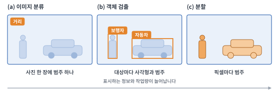
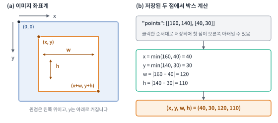
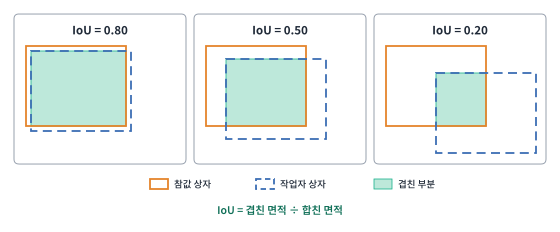

# 10주차 이론 — 이미지 라벨링

## 이미지 라벨링의 개념 {#sec-w10t-intro}

이미지 라벨링은 사진 속 대상의 종류와 위치를 정해진 기준에 따라 표시하는 작업입니다. 모델이 "고양이가 어디에 있는가"를 배우려면 고양이가 있다는 사실만이 아니라 그 위치와 범위까지 사람이 표시한 사진이 필요합니다. 이 표시가 학습 때 모델이 맞히려는 정답이 됩니다.

같은 사진도 목적에 따라 표시 방법이 달라집니다. 무엇이 있는지만 알면 되는 모델에는 사진 한 장에 범주 하나로 충분하고, 대상의 위치를 찾는 모델에는 대상마다 사각형이 필요하며, 영역의 모양까지 알아야 하는 모델에는 윤곽이 필요합니다. 표시 방법이 정해지면 쓸 도형, 좌표의 저장 형식, 검수할 항목이 따라서 정해집니다.

라벨링 결과의 가치는 이미지 수만으로 정해지지 않습니다. 같은 객체를 어떤 작업자는 표시하고 다른 작업자는 빼먹거나, 같은 대상에 서로 다른 범주명을 쓰면 모델은 일관된 기준을 배우기 어렵습니다. 그래서 작업 전에 대상 범위와 표기 규칙을 정하고, 저장한 결과를 다시 열어 검수합니다. 이 작업에 쓰는 도구가 LabelMe입니다. LabelMe에서 이미지에 도형을 그리고 범주명을 입력하면 결과가 JSON 파일로 저장됩니다.

## 이미지 데이터의 구조 {#sec-w10t-image}

컴퓨터에게 이미지는 작은 점의 격자입니다. 이 점을 화소(픽셀)라 하고, 픽셀마다 색을 나타내는 숫자가 있습니다. 가로 640, 세로 480 픽셀의 이미지는 픽셀이 307,200개이고, 컬러 이미지는 픽셀마다 빨강·초록·파랑 값이 있어서 숫자가 921,600개입니다. 컴퓨터에게 고양이는 이 숫자들의 특정한 배열일 뿐이므로, 어디서부터 어디까지가 고양이인지는 사람이 알려 주어야 합니다.

이미지가 픽셀의 격자이기 때문에 이미지 안의 위치도 격자 위의 좌표, 즉 숫자로 나타냅니다. 사각형이든 다각형이든 LabelMe가 저장하는 도형은 결국 픽셀 좌표의 목록입니다.

## 이미지 라벨링의 세 수준 {#sec-w10t-levels}

라벨에 담는 정보에 따라 분류, 검출, 분할로 나눕니다(@fig-w10-levels).

{#fig-w10-levels width=100% fig-alt="같은 거리 사진에 대해 분류는 사진 전체에 범주 하나를, 검출은 보행자와 자동차에 사각형과 범주를, 분할은 픽셀마다 범주를 붙인 모습."}

이미지 분류는 사진 전체에 범주를 붙입니다. 사진마다 대표 범주 하나를 붙이는 것이 기본이고, 과제에 따라 여러 범주를 함께 붙이기도 합니다. 사진 어디에 무엇이 있는지는 알 수 없습니다. 객체 검출은 대상마다 사각형과 범주를 붙여 위치와 개수를 알려 줍니다. 다만 사각형 안에는 배경도 섞입니다.

분할은 픽셀 단위로 어느 대상에 속하는지 표시해 윤곽까지 정확히 알려 줍니다. 같은 범주의 객체를 구별하지 않는 의미 분할과 객체마다 구별하는 인스턴스 분할이 있습니다. 사진에 자동차가 두 대 있다면 의미 분할은 둘을 합쳐 '자동차' 영역 하나로 칠하고, 인스턴스 분할은 자동차 1과 자동차 2로 나눕니다. 정밀할수록 작업 시간과 검수 비용이 커지므로 목적에 필요한 수준을 고릅니다. 자율주행처럼 도로의 경계가 필요한 분야에서는 분할을 씁니다.

세 수준이 LabelMe의 도형과 일대일로 대응하지는 않습니다. 검출에는 보통 사각형을, 분할에는 윤곽을 따라 그린 다각형을 쓰지만, 다각형 그 자체는 윤곽 좌표일 뿐이어서 픽셀별 마스크가 필요하면 따로 변환해야 합니다.

## LabelMe의 도형 {#sec-w10t-shapes}

LabelMe에서는 기록하려는 정보에 따라 도형을 고릅니다. 같은 고양이 사진이라도 대략적인 위치만 필요하면 사각형, 몸의 윤곽이 필요하면 다각형, 눈의 위치가 필요하면 점을 씁니다. 도형을 그린 뒤에는 그 도형이 가리키는 대상의 이름을 라벨로 입력합니다. 도형과 이름이 함께 있어야 표시의 뜻이 분명해집니다.

| 도형 | 기록하는 정보 | 적합한 예 | 지정하는 점 |
|---|---|---|---|
| 사각형(Rectangle) | 객체의 대략적인 위치와 범위 | 사진 속 사람·자동차의 위치 | 마주 보는 두 꼭짓점 |
| 다각형(Polygon) | 대상의 윤곽을 따른 영역 | 건물·도로·동물의 보이는 영역 | 윤곽을 따라 찍은 여러 꼭짓점 |
| 원(Circle) | 원형에 가까운 영역 | 동전·원형 표지판 | 중심과 원둘레의 한 점 |
| 점(Point) | 특정 위치나 특징점 | 눈·코·관절의 위치 | 위치 한 점 |
| 선(Line) | 두 점 사이의 선분 | 차선의 일부, 경계의 한 구간 | 시작점과 끝점 |
| 연결선(LineStrip) | 여러 점을 잇는 경로 | 굽은 차선, 길의 중심선 | 순서대로 이어지는 여러 점 |

: LabelMe 도형별 용도와 좌표 {#tbl-w10-shapes}

이 밖에도 LabelMe에는 기울어진 대상을 감싸는 회전 사각형(Oriented Rectangle), 픽셀 단위로 영역을 칠하는 마스크(Mask), 모델이 윤곽을 제안하고 사람이 고치는 AI 보조 도구가 있습니다.

사각형은 검출용 박스를 만들 때 편리합니다. 원은 원형 영역을 표시하는 도형일 뿐 원형 대상에 반드시 써야 하는 것이 아닙니다. 점과 선은 면적보다 위치, 기준점, 경로가 중요한 과제에 맞습니다.

작업 기준에는 도형과 범주명을 함께 정합니다. 고양이를 모두 사각형으로 표시하기로 했는데 한 작업자는 윤곽을 다각형으로, 다른 작업자는 눈만 점으로 찍으면 결과를 하나의 검출 데이터로 모을 수 없습니다. 한 이미지에 같은 종류의 객체가 여럿이면 각각 따로 표시하고, 범주명은 `cat`과 `고양이`처럼 섞어 쓰지 않습니다.

## 바운딩 박스 {#sec-w10t-bbox}

바운딩 박스(bounding box)는 대상을 감싸는 가장 작은 사각형입니다. 위치와 크기를 숫자 네 개로 나타내는데, 표기는 형식마다 다릅니다. COCO는 왼쪽 위 꼭짓점과 너비·높이 `(x, y, w, h)`를, Pascal VOC는 두 꼭짓점 `(x_min, y_min, x_max, y_max)`를, YOLO는 중심 좌표와 너비·높이를 이미지 크기로 나눈 값을 씁니다. LabelMe는 이 중 어느 형식도 아니고 사각형의 두 꼭짓점을 클릭한 순서대로 저장하므로, 다른 형식으로 쓰려면 변환해야 합니다.

박스는 대상을 빠짐없이 포함하면서 가장자리에 딱 맞게 그립니다. 대상보다 너무 크면 배경이 많이 섞여 모델이 배경을 대상의 특징으로 배울 수 있고, 너무 작아 대상의 일부가 잘리면 중요한 특징이 빠집니다. 이 기준을 지침에 적어 두어야 작업자마다 박스를 다르게 그리지 않습니다.

이미지에 고양이 두 마리와 강아지 한 마리가 있으면 객체마다 박스를 따로 그립니다. 같은 범주라고 해서 하나의 큰 박스로 합치지 않습니다. 대상이 없거나 기준상 판별할 수 없을 때는 임의의 박스를 만들지 않고 그 사실을 기록합니다.

## 이미지 좌표계 {#sec-w10t-coord}

수학의 좌표평면은 y가 위로 갈수록 커지지만, 이미지는 왼쪽 위 모서리가 원점 (0, 0)이고 x는 오른쪽으로, y는 아래쪽으로 갈수록 커집니다. 화면에 픽셀을 위에서 아래로 한 줄씩 그리는 방식에서 나온 관례입니다(@fig-w10-bbox).

{#fig-w10-bbox width=100% fig-alt="왼쪽 위가 원점인 이미지 좌표계와 박스의 (x, y), (x+w, y+h), 너비와 높이. 저장된 점 [[160, 140], [40, 30]]에서 (x, y, w, h) = (40, 30, 120, 110)을 계산하는 과정."}

박스의 `(x, y)`는 왼쪽 위 꼭짓점이고, 거기서 오른쪽으로 너비 `w`, 아래로 높이 `h`만큼 뻗은 사각형이 대상을 감쌉니다. 오른쪽 아래 꼭짓점은 `(x+w, y+h)`입니다. LabelMe에서는 두 점을 찍는 순서가 정해져 있지 않으므로 첫 점이 오른쪽 아래일 수도 있습니다. 박스가 필요하면 두 점의 x와 y에서 각각 최솟값을 왼쪽 위로, 두 값의 차를 너비와 높이로 삼습니다. 이 좌표는 화면을 확대하거나 축소해도 변하지 않는 원본 이미지 기준의 값입니다.

좌표를 잘못 읽으면 박스가 엉뚱한 곳에 그려지거나 이미지 밖으로 벗어납니다. 값이 픽셀 단위인지 이미지 크기로 나눈 0~1의 정규화 값인지도 함께 확인합니다.

## 박스의 면적과 IoU {#sec-w10t-calc}

박스의 면적은 너비와 높이의 곱입니다.

$$
\text{면적} = w \times h
$$ {#eq-area}

면적으로 오류 후보를 추릴 수 있습니다. 너무 작은 박스는 작업자가 실수로 클릭한 흔적일 수 있고, 너무 큰 박스는 이미지 전체를 잘못 감싼 것일 수 있습니다. 다만 큰 대상은 정상적으로도 박스가 크므로 면적은 후보를 고르는 용도로만 씁니다.

두 박스가 얼마나 겹치는지는 IoU(Intersection over Union)로 잽니다. 두 박스 $A$, $B$에서 겹친 부분의 넓이를 두 박스가 차지하는 전체 넓이로 나눈 값입니다.

$$
\mathrm{IoU}(A, B) = \frac{|A \cap B|}{|A \cup B|}
$$ {#eq-iou}

::: {.eqnote}
- $A, B$: 비교할 두 박스(예: 정답 박스와 작업자가 그린 박스)
- $|A \cap B|$: **교집합** — 두 박스가 겹치는 부분의 넓이
- $|A \cup B|$: **합집합** — 두 박스가 차지하는 전체 넓이($=|A|+|B|-|A\cap B|$)
:::

IoU는 0에서 1 사이의 값입니다. 완전히 겹치면 1이고 전혀 겹치지 않으면 0입니다. 같은 크기의 두 박스가 조금씩 더 어긋나면 IoU는 0.80, 0.50, 0.20으로 떨어집니다(@fig-w10-iou).

{#fig-w10-iou width=100% fig-alt="정답 박스와 작업자 박스가 조금, 절반쯤, 많이 어긋난 세 경우의 IoU가 각각 0.80, 0.50, 0.20."}

IoU는 같은 대상에 박스가 두 번 그려진 중복을 찾을 때, 작업자의 박스를 정답 박스와 비교할 때, 두 작업자의 박스를 비교할 때 씁니다. 몇 이상이면 통과로 볼지는 과제가 요구하는 위치 정밀도에 맞추어 정합니다.

IoU를 해석할 때 주의할 점이 두 가지 있습니다. 첫째, 같은 객체를 가리키는 박스끼리 비교해야 의미가 있습니다. 둘째, IoU가 높아도 범주가 틀렸을 수 있으므로 위치 일치만 재는 값이라고 보아야 합니다. 작은 객체는 몇 픽셀만 어긋나도 IoU가 크게 떨어지므로, 같은 기준값을 크기가 다른 객체에 그대로 적용하지 않습니다.

## 라벨링 작업 흐름 {#sec-w10t-workflow}

작업자는 먼저 사용할 이미지와 라벨 목록을 확인합니다. 거리 사진에서 `사람`, `자동차`, `신호등`만 표시한다면 무엇을 대상으로 삼고 무엇을 제외할지부터 정합니다. LabelMe에서 이미지를 열고 도형 도구를 고른 뒤 객체마다 표시하고 라벨 이름을 입력합니다. 잘못 그린 도형은 꼭짓점을 고치거나 지우고 다시 그립니다. 저장한 뒤에는 이미지와 JSON을 함께 확인합니다.

| 순서 | 작업 | 확인할 점 |
|---|---|---|
| ① 준비 | 이미지와 허용 라벨 목록 확인 | 파일을 열 수 있고 대상 범위가 분명한가 |
| ② 표시 | 목적에 맞는 도형으로 객체마다 표시 | 빠뜨리거나 합쳐 그린 객체가 없는가 |
| ③ 이름 | 도형마다 범주명 입력 | 같은 대상에 같은 이름을 썼는가 |
| ④ 수정 | 크기·위치·라벨 재확인 | 여백이 지나치거나 대상 일부가 잘리지 않았는가 |
| ⑤ 저장·재열기 | JSON 저장 후 다시 불러오기 | 이미지와 도형이 연결되고 수정 결과가 남았는가 |

: LabelMe 라벨링의 기본 작업 흐름 {#tbl-w10-workflow}

도형을 저장했다고 검수가 끝나지는 않습니다. 도형 수가 실제 대상 수와 맞는지, 라벨이 허용 목록에 있는지, 도형이 올바른 대상을 가리키는지는 사람이 이미지를 보고 확인합니다. 자동 검사는 좌표 오류를 찾는 데 쓸모가 있지만 자동차를 사람으로 잘못 표시한 의미 오류는 찾지 못합니다.

## 라벨링 지침 {#sec-w10t-guideline}

일관된 결과를 얻으려면 지침에 대상 정의, 도형 종류, 경계 기준, 예외 처리를 적어 둡니다. "사람을 표시한다"라는 문장만으로는 멀리 있는 사람, 절반이 가려진 사람, 사진 가장자리에서 잘린 사람을 어떻게 다룰지 정할 수 없습니다.

| 상황 | 미리 정할 질문 |
|---|---|
| 대상 일부가 다른 물체에 가려짐 | 보이는 부분만 감쌀지, 가려진 전체 크기를 추정할지 |
| 대상이 이미지 밖으로 잘림 | 보이는 부분만 표시할지, 어느 정도 보여야 표시할지 |
| 작은 대상·흐린 대상 | 식별할 수 있는 최소 크기와 확신 기준 |
| 같은 범주의 객체 여러 개 | 각각 별도 도형으로 표시했는지 |
| 판별할 수 없는 대상 | 추측하지 않고 보류·검토 대상으로 남길지 |

: 작업 전에 합의할 경계 사례 {#tbl-w10-guideline}

보이는 부분만 감싸기로 했다면 가려진 자동차의 숨은 차체를 상상해 박스를 넓히지 않습니다. 유일하게 옳은 기준이 있는 것은 아닙니다. 사용 목적에 맞게 기준을 정하고 모든 이미지에 똑같이 적용하면 됩니다. 지침에는 대표 예시와 반례를 함께 넣고, 애매한 이미지는 따로 기록해 함께 판정합니다.

## 라벨 파일의 형식 {#sec-w10t-schema}

LabelMe는 이미지마다 JSON 파일 하나를 저장하는 것이 일반적입니다. 파일에는 이미지 경로(`imagePath`), 이미지 크기(`imageWidth`, `imageHeight`), 도형 목록(`shapes`)이 들어갑니다. `shapes`의 원소 하나가 도형 하나이고, `label`은 범주명, `shape_type`은 도형 종류, `points`는 원본 이미지 좌표입니다. `imageData`에는 설정에 따라 이미지 자체를 인코딩한 값이 들어가거나 `null`이 들어갑니다. `null`이면 `imagePath`를 따라 실제 이미지 파일을 찾을 수 있어야 합니다.

```json
{
  "label": "고양이",
  "shape_type": "rectangle",
  "points": [[160, 140], [40, 30]]
}
```

위는 `shapes` 배열에 들어가는 도형 하나를 줄여 쓴 것입니다. 같은 `points`라도 `shape_type`이 `circle`이면 중심과 둘레의 한 점, `polygon`이면 윤곽의 꼭짓점들이라서 점의 의미가 달라집니다.

| 구분 | 주된 용도 | 사각형의 표현 |
|---|---|---|
| LabelMe JSON | 화면에서 만든 라벨의 원본 저장 | `shape_type: rectangle`과 두 점의 `points` |
| COCO JSON | 여러 이미지·범주·어노테이션을 묶어 교환·학습 | 어노테이션의 `bbox: [x, y, w, h]` |
| SQLite 테이블 | 필요한 항목을 조회·집계하려는 별도 저장 구조 | 설계한 열에 따라 다름 |

: 라벨 데이터 형식의 역할 {#tbl-w10-formats}

세 형식이 같은 내용을 담을 수는 있어도 서로 그대로 읽히지는 않습니다. LabelMe JSON을 COCO로 쓰려면 이미지와 범주에 ID를 붙이고 각 사각형의 두 점을 `(x, y, w, h)`로 바꿔야 합니다. COCO의 박스를 두 꼭짓점으로 되돌릴 때는 오른쪽 아래를 `(x+w, y+h)`로 계산합니다. SQLite는 라벨을 분석하거나 관리하려고 고르는 저장 방식이며 LabelMe가 자동으로 만들어 주는 결과물이 아닙니다.

변환할 때는 원본 JSON을 그대로 보존하고, 변환한 결과는 이미지 위에 박스를 다시 그려 위치를 확인합니다. 스마트폰 사진처럼 EXIF에 회전 정보가 들어 있는 이미지는 특히 주의합니다. LabelMe는 회전 정보를 적용한 방향으로 이미지를 보여 주고 그 방향의 좌표를 저장합니다. 학습 코드가 회전 정보를 무시하고 이미지를 읽으면 박스가 엉뚱한 곳을 가리킵니다. 90도 회전이라면 읽은 이미지의 가로·세로가 JSON의 `imageWidth`·`imageHeight`와 뒤바뀌므로 크기 비교로 찾을 수 있습니다. 180도 회전은 크기가 같아서 이미지 위에 박스를 그려 보아야 드러납니다.

## 라벨의 검수 {#sec-w10t-valid}

저장한 JSON은 형식 검수와 내용 검수로 나누어 봅니다. 형식 검수에서는 JSON이 열리는지, `imagePath`가 실제 이미지를 가리키는지, `imageWidth`·`imageHeight`가 이미지 크기와 맞는지, 도형마다 라벨과 좌표가 있는지 확인합니다. 사각형이라면 두 점에서 구한 너비와 높이가 양수인지도 봅니다. 좌표가 음수이거나 이미지 경계를 넘으면 오류 후보로 기록합니다.

내용 검수에서는 빠진 객체, 잘못된 범주, 겹치거나 중복된 도형, 기준과 다른 경계를 이미지 위에서 확인합니다. 좌표가 유효해도 사람을 자동차로 표시한 오류는 숫자만으로 찾을 수 없습니다. 반대로 두 박스의 IoU가 높아도 실제로 두 객체가 겹쳐 있는 장면일 수 있으므로, 자동 검사에 걸렸다고 곧바로 지우지 않습니다.

검수 기록에는 파일명, 문제 도형, 오류 유형, 수정 여부를 남깁니다. 일부 이미지를 여러 사람이 독립적으로 라벨링했다면 같은 객체로 짝지은 도형끼리 범주와 위치를 비교할 수 있습니다. 이때 IoU는 위치가 일치하는지만 재는 값이며 라벨 품질 전체를 대신하지 않습니다.

## 이미지 품질과 데이터 구성 {#sec-w10t-imgquality}

원본 이미지가 흐리거나 어두워 대상이 식별되지 않으면 도형을 아무리 정밀하게 그려도 라벨을 믿기 어렵습니다. 작업 전에 파일이 열리는지, 해상도가 충분한지, 대상이 보이는지 확인하고, 판단할 수 없는 이미지는 따로 보류합니다.

품질이 낮은 이미지를 모두 지우는 것도 좋은 방법이 아닙니다. 실제 사용 환경에 흐린 장면이 섞여 있다면 그런 장면을 어느 수준까지 포함하고 어떻게 표시할지를 목적에 맞게 정합니다. 보류하거나 제외한 이미지는 수와 이유를 기록해 두어야 최종 데이터의 한계를 설명할 수 있습니다.

이미지의 구성도 봅니다. 비슷한 장면만 많으면 아무리 많이 라벨링해도 모델이 다양한 상황에 대응하기 어렵고, 일부 범주만 많으면 나머지 범주를 배울 기회가 줄어듭니다. 최종 파일 수만 볼 것이 아니라 범주별 객체 수와 보류 사유까지 살펴야 데이터셋을 어디에 쓸 수 있는지 판단할 수 있습니다.

## 이미지 라벨링과 개인정보 {#sec-w10t-privacy}

이미지에는 얼굴, 자동차 번호판, 신분증처럼 개인을 알아볼 수 있는 정보가 쉽게 들어갑니다. 텍스트와 달리 눈에 띄지 않아 놓치기도 쉽습니다. 배경에 우연히 찍힌 사람의 얼굴, 멀리 보이는 간판의 전화번호도 개인정보가 될 수 있습니다.

거리 사진이나 CCTV 영상을 라벨링한다면 얼굴과 번호판을 어떻게 처리할지 작업 전에 정합니다. 흐리게 처리하거나 가리는 것이 흔한 방법입니다. 얼굴을 인식하는 모델처럼 얼굴 자체가 필요하다면 촬영과 활용에 대한 동의를 받고 관련 법규를 지켜야 합니다. 작업자가 이미지를 보는 순간 개인정보를 접하게 되므로, 이미지 한 장을 열 때마다 알아볼 수 있는 정보가 없는지 확인하는 습관이 필요합니다.

## 이미지 라벨링의 핵심 개념 {#sec-w10t-summary}

| 개념 | 설명 |
|---|---|
| 분류·검출·분할 | 사진 전체의 범주, 대상별 사각형과 범주, 픽셀별 범주. 목적에 필요한 수준만 고름 |
| LabelMe 도형 | 사각형·다각형·원·점·선·연결선. 도형 종류가 `shape_type`에, 좌표가 `points`에 저장됨 |
| 바운딩 박스 | 대상을 감싸는 가장 작은 사각형. 객체마다 하나씩 |
| 이미지 좌표계 | 왼쪽 위가 원점, y는 아래로 커짐. 두 점에서 `(x, y, w, h)`를 계산 |
| IoU | 겹친 넓이를 합친 넓이로 나눈 값. 위치의 일치만 재며 범주 오류는 알 수 없음 |
| 라벨링 지침 | 대상 정의, 도형, 경계 기준, 예외 처리. 가림·잘림·작은 대상의 처리를 미리 정함 |
| 라벨 파일 형식 | LabelMe JSON은 작업 원본, COCO는 학습·교환용, SQLite는 조회·집계용. 변환 뒤 이미지 위에서 재확인 |
| 형식 검수와 내용 검수 | 파일·좌표의 유효성은 자동으로, 빠진 객체·범주 오류는 사람이 이미지로 확인 |
| 개인정보 | 얼굴·번호판·간판 등은 작업 전에 처리 방식을 정함 |

: 이미지 라벨링의 핵심 개념 {#tbl-w10-concepts}
