# 11주차 이론 — 머신러닝·딥러닝 모델과 반복 학습 프로세스

## 모델 학습의 개요 {#sec-w11t-intro}

모델은 입력 데이터에서 정답을 맞히는 규칙을 학습한 함수입니다. 수집하고 정제하고 라벨링한 데이터는 여기서 모델의 재료가 됩니다. 표의 열이나 이미지·문장이 **입력 특성 $X$**가 되고, 라벨이 **목표값 $y$**가 되며, 모델은 $X$에서 $y$를 맞히는 규칙 $f$를 찾습니다. 학습을 마친 모델에 새 입력을 넣으면 **예측값 $\hat{y} = f(X)$**를 얻습니다.

정답 $y$가 있는 데이터로 배우는 방식을 지도학습, 정답 없이 데이터의 구조를 찾는 방식을 비지도학습이라고 합니다. 회귀와 분류는 지도학습이고, 군집과 차원 축소는 비지도학습입니다.

머신러닝은 데이터에서 규칙을 학습하는 방법 전체를 가리키고, 딥러닝은 그중 여러 층의 신경망을 쓰는 방법입니다. 표 데이터에서는 트리 기반 모델 같은 머신러닝 모델이 강하고, 이미지·텍스트·음성처럼 구조가 복잡한 데이터에서는 딥러닝 모델이 주로 쓰입니다. 어느 쪽이 항상 낫지는 않으므로, 데이터의 종류와 양, 해석의 필요성, 계산 자원을 함께 보고 고릅니다.

| 용어 | 뜻 | 예 |
|---|---|---|
| 특성(feature) $X$ | 예측에 쓰는 입력 정보 | 시간대, 기온, 요일 |
| 목표값(target) $y$ | 맞혀야 할 정답 | 다음 시간 대여량 |
| 예측값 $\hat{y}$ | 모델이 내놓은 값 | 132대 |
| 파라미터 | 학습으로 정해지는 값 | 회귀 계수, 신경망 가중치 |
| 하이퍼파라미터 | 학습 전에 사람이 정하는 설정 | 트리 깊이, 학습률, 층 수 |
| 손실 함수 | 학습 중 줄이려는 오차의 크기 | 제곱오차, 교차엔트로피 |
| 평가 지표 | 목적에 맞는 성능의 척도 | MAE, 재현율, F1 |
| 학습·검증·테스트 데이터 | 학습용, 설정 선택용, 최종 확인용 | 60%·20%·20% |

: 모델 학습의 기본 용어 {#tbl-w11-terms}

이 장의 코드에서 `X_train`, `y_train`은 학습 데이터의 입력과 정답, `X_val`·`y_val`과 `X_test`·`y_test`는 검증·테스트 데이터를 뜻합니다. 머신러닝 모델은 scikit-learn, 딥러닝 모델은 PyTorch로 적었습니다. scikit-learn의 모델은 종류와 상관없이 `fit()`으로 학습하고 `predict()`로 예측하므로, 모델을 바꿀 때는 모델을 만드는 한 줄만 바꾸면 됩니다.

## 머신러닝 프로젝트의 반복 과정 {#sec-w11t-process}

모델 개발은 한 번 학습하고 끝나는 작업이 아닙니다. 문제를 정의하고 데이터를 살펴본 뒤 단순한 기준 모델을 만들고, 예측과 오류를 분석해 특성과 설정을 고치는 과정을 되풀이합니다(@fig-w11-process). 이 반복은 검증 데이터로 하고, 테스트 데이터는 마지막에 한 번만 씁니다.

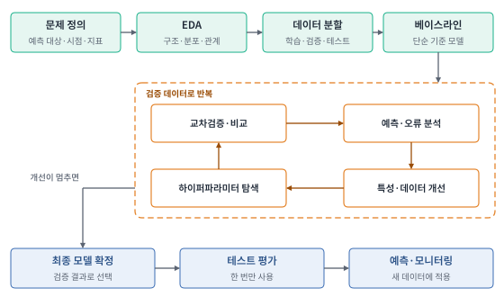{#fig-w11-process width=100% fig-alt="문제 정의, EDA, 데이터 분할, 베이스라인을 거쳐 예측·오류 분석, 특성·데이터 개선, 하이퍼파라미터 탐색, 교차검증·비교를 반복한 뒤 최종 모델 확정, 테스트 평가, 예측·모니터링으로 이어지는 흐름."}

### 문제 정의

대여소의 다음 시간 자전거 수요를 예측한다고 하겠습니다. "자전거 데이터를 분석한다"만으로는 모델을 만들 수 없습니다. 예측 단위는 대여소별 1시간, 정답은 다음 시간 대여량, 예측 시점은 현재 시각처럼 구체적으로 정해야 합니다.

다음 시간의 실제 대여량은 예측 시점에 알 수 없으므로 입력에 넣으면 안 됩니다. 날씨도 예측 시점에 쓸 수 있는 예보인지, 나중에 확정된 관측값인지 구분합니다. 예측 시점에 알 수 없는 정보가 입력에 섞이는 것을 **데이터 누수**라고 하며, 누수가 있으면 검증 점수는 높게 나와도 실제 예측에서는 성능이 크게 떨어집니다.

| 정의 항목 | 회귀로 정의 | 분류로 정의 |
|---|---|---|
| 해결할 질문 | 다음 시간에 몇 대가 필요한가 | 다음 시간에 수요가 높은가 |
| 정답 | 대여량 125대 | 높음 또는 보통 |
| 활용 | 배치할 자전거 수 결정 | 수요 경보 전송 |
| 오류 비용 | 30대가 부족하면 운영 차질 | 고수요를 놓치면 대응 실패 |

: 같은 데이터에서 출발한 두 가지 문제 정의 {#tbl-w11-define}

### 탐색적 데이터 분석

탐색적 데이터 분석(EDA)은 모델에 넣기 전에 데이터가 무엇을 담고 있는지 확인하는 과정입니다. 행 하나의 의미, 열의 자료형과 단위, 수집 기간, 정답의 정의를 먼저 확인하고, 결측값·중복·범위 밖의 값·클래스 비율을 점검합니다. 숫자로 저장된 대여소 번호처럼 숫자처럼 보이지만 크기에 의미가 없는 열도 구분합니다.

| 시각화 | 확인할 내용 | 후속 조치 |
|---|---|---|
| 히스토그램 | 수치 분포와 치우침 | 로그 변환 후보 확인 |
| 박스플롯 | 집단별 분포와 극단값 | 오류인지 드문 실제 사례인지 확인 |
| 산점도 | 입력과 목표의 관계 | 비선형 관계·상호작용 후보 확인 |
| 막대그래프 | 클래스 수와 범주별 비율 | 불균형과 대표성 점검 |
| 시간별 선그래프 | 추세·주기·구간 변화 | 시간 순서 분할, 과거값 특성 검토 |
| 상관행렬 | 수치 변수 사이의 선형 관계 | 중복 특성 검토. 상관을 인과로 단정하지 않음 |

: EDA에서 쓰는 시각화 {#tbl-w11-eda}

### 데이터 분할

데이터는 학습, 검증, 테스트로 나눕니다(@fig-w11-split). 학습 데이터로 파라미터를 맞추고, 검증 데이터로 모델과 하이퍼파라미터를 고르며, 테스트 데이터로 최종 성능을 확인합니다. 테스트 점수를 보고 모델을 다시 고치면 테스트도 사실상 검증 데이터가 되어 최종 성능을 부풀리게 됩니다.

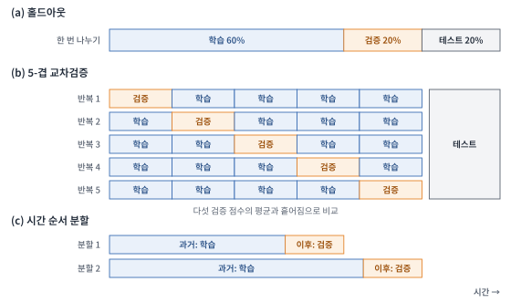{#fig-w11-split width=100% fig-alt="홀드아웃은 학습 60%, 검증 20%, 테스트 20%로 나눈다. 5-겹 교차검증은 다섯 구간 중 하나씩을 검증으로 쓴다. 시간 순서 분할은 과거 구간으로 학습하고 그 이후 구간으로 검증한다."}

K-겹 교차검증은 학습 데이터를 K부분으로 나누고 한 부분씩 번갈아 검증에 써서 K개의 점수를 얻습니다. 점수의 평균으로 성능을, 흩어짐으로 안정성을 판단합니다. 데이터의 성격에 따라 나누는 방법을 고릅니다.

| 데이터의 성격 | 분할 방법 | 이유 |
|---|---|---|
| 클래스가 불균형함 | 층화 분할 | 각 구간의 클래스 비율을 전체와 같게 유지 |
| 같은 사람·기기의 반복 관측 | 그룹 분할 | 같은 대상이 학습과 검증에 함께 들어가지 않게 함 |
| 시간 순서가 있음 | 시간 순서 분할 | 미래 데이터로 과거를 맞히는 누수를 막음 |
| 같은 원본에서 나온 이미지·문장 | 원본 단위 분할 | 거의 같은 사례가 양쪽에 들어가는 것을 막음 |

: 데이터 성격에 따른 분할 방법 {#tbl-w11-splitkind}

결측 대체값, 스케일링 기준, 인코딩 범주 같은 변환 기준은 학습 데이터에서만 정하고 검증·테스트에는 그 기준을 그대로 적용합니다. 전체 데이터로 기준을 정하면 검증 데이터의 정보가 학습에 새어 들어갑니다.

```python
from sklearn.model_selection import train_test_split, cross_val_score
X_train, X_test, y_train, y_test = train_test_split(X, y, test_size=0.2, stratify=y, random_state=42)
scores = cross_val_score(model, X_train, y_train, cv=5)    # 5-겹 교차검증 점수 5개
```

### 베이스라인 모델

베이스라인은 복잡한 모델보다 먼저 만드는 비교 기준입니다. 회귀에서는 학습 목표값의 평균을, 분류에서는 가장 많은 클래스를 항상 예측하는 모델이 가장 단순한 기준입니다. 그다음 선형회귀나 로지스틱 회귀 같은 간단한 모델과 비교합니다.

회귀 베이스라인의 MAE가 30대이고 새 모델이 22대라면 개선을 수치로 설명할 수 있습니다. 복잡한 모델이 단순 기준조차 이기지 못하면 입력에 정보가 부족하거나 구현·분할에 문제가 있다는 신호입니다. 비교할 때는 항상 같은 분할과 같은 지표를 씁니다.

```python
from sklearn.dummy import DummyRegressor, DummyClassifier
base = DummyRegressor(strategy="mean").fit(X_train, y_train)     # 회귀: 평균 예측
# 분류라면 DummyClassifier(strategy="most_frequent")로 최빈 클래스 예측
```

### 예측과 오류 분석

학습은 $X$와 $y$로 모델을 맞추는 단계이고, 예측은 $X$만 넣어 $\hat{y}$를 얻는 단계입니다. 검증 데이터의 예측 결과를 원본 행에 붙여 오차가 큰 사례, 틀린 클래스, 특정 시간대나 집단의 성능을 살펴봅니다. "정확도가 90%다"에서 멈추지 않고 "야간 데이터에서는 무엇을 놓치는가"를 묻는 것이 오류 분석이며, 다음 반복에서 무엇을 바꿀지는 여기서 정해집니다. 오류의 원인이 라벨 오류로 드러나면 라벨링 단계로 돌아가 데이터를 고칩니다.

### 피처 엔지니어링

피처 엔지니어링은 원본 열에서 문제에 유용한 표현을 만드는 일입니다. 날짜에서 요일과 시간대를 뽑고, 구매 금액과 횟수로 평균 구매액을 만들며, 시계열에서는 과거값(시차 특성)이나 과거 이동평균을 만듭니다. 미래 값이 포함된 이동평균은 예측 시점에 알 수 없으므로 누수입니다. 특성을 추가한 뒤에는 같은 검증 방식으로 이전 모델과 비교해, 실제로 나아졌을 때만 남깁니다.

### 하이퍼파라미터 탐색

하이퍼파라미터는 학습 전에 정하는 설정이라 데이터에서 자동으로 정해지지 않습니다. 후보 조합을 여러 개 학습해 검증 점수가 가장 좋은 것을 고릅니다.

| 방법 | 탐색 방식 | 주의점 |
|---|---|---|
| 그리드 탐색 | 정해 둔 조합을 모두 학습 | 조합이 많아지면 계산량이 급격히 늘어남 |
| 무작위 탐색 | 범위 안에서 조합을 무작위로 뽑음 | 탐색 횟수와 범위를 정해야 함 |
| 베이지안 최적화 | 앞선 결과로 다음 후보를 고름 | 적은 시도로 좋은 조합을 찾지만 설정이 복잡함 |

: 하이퍼파라미터 탐색 방법 {#tbl-w11-hpo}

```python
from sklearn.model_selection import GridSearchCV
search = GridSearchCV(model, {"max_depth": [3, 5, 7]}, cv=5).fit(X_train, y_train)
print(search.best_params_, search.best_score_)    # 가장 좋은 설정과 교차검증 점수
```

### 실험 기록과 최종 평가

데이터나 모델을 바꿀 때마다 분할 방식, 주 지표, 사용한 특성, 하이퍼파라미터, 검증 점수, 소요 시간을 기록합니다. 기록이 없으면 어느 변경이 성능을 올렸는지 설명할 수 없습니다.

| 실험 | 변경 내용 | 검증 지표 | 다음 판단 |
|---|---|---|---|
| 0 | 평균·최빈값 예측 | 기준 점수 | 학습 모델과 비교 |
| 1 | 선형 모델 | 기준 대비 개선 여부 | 큰 오차 사례 분석 |
| 2 | 시간대 특성 추가 | 같은 검증 방식으로 측정 | 유효한 특성인지 판단 |
| 3 | 트리 앙상블과 설정 탐색 | 교차검증 평균과 흩어짐 | 복잡도에 비해 이득이 있는지 판단 |

: 실험 기록의 예 {#tbl-w11-log}

개선이 더 이상 나오지 않으면 최종 모델을 확정하고 테스트 데이터로 한 번 평가합니다. 운영 중에 입력 분포나 오류 비용이 바뀌면 데이터 수집·라벨링·재학습으로 돌아갑니다.

## 회귀와 분류 {#sec-w11t-tasks}

### 회귀

회귀는 연속적인 수치를 예측하는 문제입니다. 주택 가격, 배송 소요 시간, 다음 시간 대여량이 예입니다. 정답과 예측값의 차이가 의미를 가지므로, 100대를 102대로 예측한 것과 200대로 예측한 것은 다르게 평가합니다.

목표가 숫자로 저장됐다고 모두 회귀는 아닙니다. 0=고양이, 1=개, 2=새는 범주를 숫자로 적은 코드이므로 분류입니다. 반대로 대여량은 정수이지만 수량의 차이가 중요하므로 회귀로 다룹니다.

### 분류

이진 분류는 스팸과 정상처럼 두 클래스를, 다중 클래스 분류는 고양이·개·새 중 하나를 예측합니다. 다중 라벨 분류는 사진 한 장에 사람과 자동차가 함께 있을 때처럼 여러 라벨을 동시에 붙입니다.

분류 모델은 보통 클래스별 확률이나 점수를 출력합니다. 이진 분류에서는 확률이 임곗값 이상이면 양성으로 판단합니다. 임곗값을 낮추면 더 많은 사례를 양성으로 잡아 재현율이 오르는 대신 거짓 경보가 늘어날 수 있습니다.

| 같은 원천 데이터 | 회귀로 정의 | 분류로 정의 |
|---|---|---|
| 자전거 대여 기록 | 다음 시간 대여량 | 다음 시간 고수요 여부 |
| 쇼핑 기록 | 다음 달 구매 금액 | 다음 달 구매 여부 |
| 센서 기록 | 다음 시점 온도 | 고장 발생 여부 |

: 같은 데이터의 회귀·분류 정의 {#tbl-w11-regcls}

### 그 밖의 문제 유형

모델 계열과 문제 유형은 별개의 구분입니다. 신경망도 출력층과 손실 함수를 바꾸면 회귀와 분류에 모두 쓸 수 있습니다. 프로젝트에서 자주 만나는 문제 유형을 출력의 모양으로 나누면 아래 표와 같습니다.

| 문제 유형 | 출력 | 예 | 대표 모델 |
|---|---|---|---|
| 회귀 | 수치 하나 | 수요량, 가격 | 선형회귀, 트리 앙상블, MLP |
| 분류 | 클래스와 확률 | 스팸 여부, 불량 여부 | 로지스틱 회귀, 트리 앙상블, CNN |
| 객체 검출 | 상자 좌표와 클래스 | 사진 속 자동차 위치 | YOLO, Faster R-CNN |
| 분할 | 픽셀별 클래스 | 도로 영역, 병변 영역 | U-Net, Mask R-CNN |
| 시계열 예측 | 다음 시점들의 값 | 내일 전력 수요 | 시차 특성+부스팅, LSTM |
| 군집 | 비슷한 사례의 묶음 | 고객 세분화 | k-평균 |
| 이상 탐지 | 정상에서 벗어난 정도 | 카드 부정 사용, 설비 이상 | Isolation Forest |

: 문제 유형과 대표 모델 {#tbl-w11-tasktypes}

## 평가 지표 {#sec-w11t-metrics}

### 회귀 지표

정답을 $y_i$, 예측값을 $\hat y_i$, 사례 수를 $n$이라고 합니다.

$$
MAE=\frac{1}{n}\sum_i |y_i-\hat y_i|,\qquad
MSE=\frac{1}{n}\sum_i(y_i-\hat y_i)^2
$$

$$
RMSE=\sqrt{MSE},\qquad
R^2=1-\frac{\sum_i(y_i-\hat y_i)^2}{\sum_i(y_i-\bar y)^2}
$$

| 지표 | 해석 | 좋은 방향 | 주의점 |
|---|---|---|---|
| MAE | 평균 절대오차 | 작을수록 좋음 | 목표와 같은 단위 |
| MSE | 오차 제곱의 평균 | 작을수록 좋음 | 큰 오차에 큰 벌점, 단위도 제곱 |
| RMSE | MSE의 제곱근 | 작을수록 좋음 | 같은 단위이며 큰 오차에 민감 |
| R² | 평균 예측 대비 설명 정도 | 클수록 좋음, 최대 1 | 평가 데이터에서는 음수도 가능 |
| MAPE | 실제값 대비 절대오차 비율의 평균 | 작을수록 좋음 | 실제값이 0이거나 매우 작으면 부적절 |

: 회귀 평가 지표 {#tbl-w11-regmetrics}

실제값이 [10, 20, 30], 예측값이 [12, 18, 36]이면 절대오차는 [2, 2, 6]입니다. MAE는 약 3.33, MSE는 약 14.67, RMSE는 약 3.83입니다. 큰 실수가 특히 문제라면 RMSE를 함께 봅니다. R²=0은 평가 데이터의 평균을 예측한 것과 제곱오차가 같다는 뜻이며, 정답을 하나도 못 맞혔다는 뜻이 아닙니다.

```python
from sklearn.metrics import mean_absolute_error, root_mean_squared_error, r2_score
y_pred = model.predict(X_val)
print(mean_absolute_error(y_val, y_pred), root_mean_squared_error(y_val, y_pred), r2_score(y_val, y_pred))
```

### 혼동행렬과 분류 지표

먼저 어떤 클래스를 **양성(positive)**으로 볼지 정합니다. 고장 탐지라면 고장을 양성으로 둡니다.

| 실제 / 예측 | 양성 예측 | 음성 예측 |
|---|---|---|
| 실제 양성 | TP: 고장을 찾아냄 | FN: 고장을 놓침 |
| 실제 음성 | FP: 정상인데 고장 경보 | TN: 정상을 정상으로 판단 |

: 혼동행렬 {#tbl-w11-confusion}

$$
Accuracy=\frac{TP+TN}{TP+TN+FP+FN},\qquad
Precision=\frac{TP}{TP+FP},\qquad Recall=\frac{TP}{TP+FN}
$$

$$
F1=\frac{2\cdot Precision\cdot Recall}{Precision+Recall}
$$

정밀도는 양성이라고 예측한 것 중 실제 양성의 비율이고, 재현율은 실제 양성 중 찾아낸 비율입니다. 정상 메일을 스팸으로 잘못 분류하는 것이 문제라면 정밀도를, 위험 사례를 놓치는 것이 문제라면 재현율을 중시합니다.

TP=8, FP=2, FN=4, TN=86이면 정확도는 94%, 정밀도는 80%, 재현율은 약 66.7%, F1은 약 72.7%입니다. 정확도가 높아도 재현율은 낮을 수 있습니다.

```python
from sklearn.metrics import confusion_matrix, classification_report
print(confusion_matrix(y_val, y_pred))
print(classification_report(y_val, y_pred))    # 클래스별 정밀도·재현율·F1
```

### 불균형 데이터와 확률 평가

정상 990개와 고장 10개에서 모두 정상으로 예측하면 정확도는 99%이지만 고장 재현율은 0%입니다. 양성이 드문 문제에서는 정확도만으로 모델을 고르면 안 됩니다.

| 지표 | 평가하는 것 | 주의할 점 |
|---|---|---|
| ROC-AUC | 여러 임곗값에서 양성과 음성을 구별하는 순위 능력 | 클래스가 아니라 확률·점수로 계산 |
| PR 곡선·AP | 정밀도와 재현율의 관계 | 양성이 드문 문제에서 함께 확인 |
| 로그 손실 | 정답 클래스에 준 확률 | 작을수록 좋음. 확신한 오답에 큰 벌점 |
| Macro F1 | 클래스별 F1의 단순 평균 | 모든 클래스를 같은 비중으로 평가 |
| Weighted F1 | 클래스 크기로 가중한 F1 평균 | 다수 클래스의 영향이 큼 |

: 불균형·확률 예측 평가 지표 {#tbl-w11-imbalance}

AUC가 높다고 확률값 자체가 정확한 것은 아닙니다. 임곗값 선택, 확률의 품질, 집단별 성능은 따로 확인합니다.

```python
from sklearn.metrics import roc_auc_score
proba = model.predict_proba(X_val)[:, 1]    # 양성 확률
print(roc_auc_score(y_val, proba))
```

## 과적합과 일반화 {#sec-w11t-overfit}

모델의 목표는 학습 데이터를 맞히는 것이 아니라 처음 보는 데이터를 잘 맞히는 것, 즉 **일반화**입니다. 모델이 너무 단순하면 학습 데이터의 경향조차 따라가지 못하는 **과소적합**이 생기고, 너무 복잡하면 학습 데이터의 잡음까지 외워 새 데이터에서 틀리는 **과적합**이 생깁니다(@fig-w11-fit).

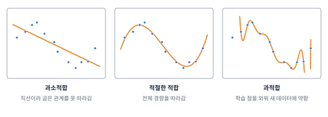{#fig-w11-fit width=100% fig-alt="직선은 굽은 데이터를 따라가지 못하고, 적절한 곡선은 전체 경향을 따라가며, 지나치게 복잡한 곡선은 모든 점을 지나도록 크게 출렁인다."}

| 증상 | 판단 | 대응 |
|---|---|---|
| 학습 점수와 검증 점수가 모두 낮음 | 과소적합 | 더 표현력 있는 모델, 유용한 특성 추가, 규제 완화 |
| 학습 점수는 높고 검증 점수는 낮음 | 과적합 | 데이터 추가, 규제 강화, 모델 단순화, 조기 종료 |
| 둘 다 높고 차이가 작음 | 적절 | 테스트로 최종 확인 |

: 학습·검증 점수로 보는 적합 상태 {#tbl-w11-fitcheck}

복잡도를 억제하는 방법을 **규제**라고 합니다. 모델마다 규제하는 손잡이가 다릅니다.

| 모델 | 복잡도를 조절하는 설정 |
|---|---|
| 선형·로지스틱 회귀 | L2(Ridge)·L1(Lasso) 벌점의 세기 |
| SVM | C(작을수록 규제가 강함), RBF 커널의 gamma |
| k-NN | k(클수록 경계가 부드러움) |
| 의사결정나무 | 최대 깊이, 잎의 최소 사례 수 |
| 그래디언트 부스팅 | 학습률, 트리 수, 트리 깊이, 표본·특성 추출 비율 |
| 신경망 | 가중치 감쇠, 드롭아웃, 조기 종료, 데이터 증강 |

: 모델별 규제 설정 {#tbl-w11-regularize}

## 선형 모델 {#sec-w11t-linear}

### 선형회귀

선형회귀는 입력의 가중합으로 수치를 예측합니다(@fig-w11-linear (a)).

$$
\hat y=b+w_1x_1+w_2x_2+\cdots+w_px_p
$$

각 입력 $x_j$에 가중치 $w_j$를 곱해 더하고 절편 $b$를 더한 값이 그대로 예측값입니다. 학습은 예측과 정답의 제곱오차 합이 가장 작아지는 $w$와 $b$를 찾는 일입니다. 입력이 하나면 단순 선형회귀, 여럿이면 다중 선형회귀라고 합니다.

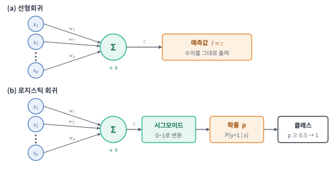{#fig-w11-linear width=100% fig-alt="입력 x1부터 xp가 가중치 w1부터 wp를 거쳐 합산 노드로 모인다. 선형회귀는 합을 예측값으로 내고, 로지스틱 회귀는 시그모이드, 확률, 임곗값을 거쳐 클래스를 낸다."}

계수 $w_j$는 다른 입력이 같을 때 $x_j$가 1 늘면 예측이 얼마나 변하는지를 뜻하므로 해석이 쉽습니다. 다만 이것은 모델 안에서의 관계일 뿐 인과 효과가 아닙니다. 굽은 관계는 그대로 표현하지 못하고, 극단값과 서로 강하게 연관된 입력에 영향을 받습니다. Ridge는 계수 제곱의 합(L2), Lasso는 계수 절댓값의 합(L1)을 벌점으로 더해 계수가 지나치게 커지지 않게 하며, Lasso는 일부 계수를 0으로 만들어 특성을 고르는 효과도 있습니다.

```python
from sklearn.linear_model import LinearRegression
model = LinearRegression().fit(X_train, y_train)    # Ridge(alpha=1.0), Lasso(alpha=0.1)로 바꾸면 규제 추가
print(model.coef_, model.intercept_)                # 가중치 w와 절편 b
```

### 로지스틱 회귀

이름에 회귀가 들어가지만 **분류 모델**입니다. 입력의 가중합 $z$를 시그모이드 함수에 넣어 0과 1 사이의 양성 확률로 바꿉니다(@fig-w11-linear (b)).

$$
z=b+\sum_jw_jx_j,\qquad P(y=1\mid x)=\sigma(z)=\frac{1}{1+e^{-z}}
$$

확률이 임곗값(보통 0.5) 이상이면 양성으로 분류합니다. 학습은 정답 클래스에 높은 확률을 주도록 로그 손실을 줄이는 방향으로 합니다. 클래스가 셋 이상이면 클래스마다 점수 $z_k$를 계산하고 소프트맥스로 확률을 만듭니다.

$$
P(y=k\mid x)=\frac{e^{z_k}}{\sum_{m}e^{z_m}}
$$

빠르고 해석이 쉬워 분류 문제의 첫 번째 비교 모델로 알맞습니다. 결정 경계가 입력 공간에서 직선(평면)이므로 복잡한 경계가 필요하면 특성을 확장하거나 다른 모델을 씁니다. 입력의 크기 차이에 영향을 받으므로 스케일링을 합니다.

```python
from sklearn.linear_model import LogisticRegression
model = LogisticRegression(C=1.0, max_iter=1000).fit(X_train, y_train)
proba = model.predict_proba(X_val)[:, 1]    # 양성 확률 p, model.predict()는 0.5 기준 클래스
```

## 서포트 벡터 머신 {#sec-w11t-svm}

서포트 벡터 머신(SVM)은 두 클래스 사이를 가르는 경계 중에서 **마진**, 즉 경계와 가장 가까운 점까지의 거리가 가장 큰 경계를 찾습니다(@fig-w11-svm (a)). 경계에 가장 가까이 있어 경계를 결정하는 점들을 **서포트 벡터**라고 합니다. 마진이 넓을수록 새 데이터가 조금 달라져도 같은 쪽으로 분류될 여유가 큽니다.

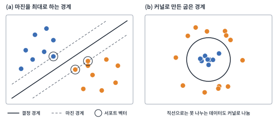{#fig-w11-svm width=100% fig-alt="파랑과 주황 점 사이에 실선 결정 경계와 양쪽 점선 마진 경계가 있고, 점선 위의 점 세 개가 서포트 벡터로 표시된다. 오른쪽은 가운데 파랑 점들과 바깥 주황 점들을 원형 경계로 나눈다."}

현실의 데이터는 완전히 나뉘지 않으므로 일부 점이 마진 안쪽이나 반대편에 오는 것을 허용합니다. 하이퍼파라미터 C가 그 허용 정도를 정하며, C가 크면 학습 데이터의 오류를 줄이려고 경계가 복잡해지고, 작으면 마진을 넓게 잡아 규제가 강해집니다.

직선으로 나눌 수 없는 데이터에는 **커널**을 씁니다(@fig-w11-svm (b)). 커널은 데이터를 더 높은 차원으로 옮긴 것처럼 계산해, 그 공간의 직선 경계가 원래 공간에서는 굽은 경계가 되게 합니다. 가장 많이 쓰는 RBF 커널에서는 gamma가 각 점의 영향 범위를 정하며, 클수록 경계가 구불구불해집니다.

거리 기반이라 스케일링이 꼭 필요하고, 데이터가 수십만 건을 넘으면 학습이 느려집니다. 회귀에 쓰는 변형은 SVR입니다. SVM의 출력 점수는 확률이 아니므로 확률이 필요하면 별도로 보정합니다.

```python
from sklearn.pipeline import make_pipeline
from sklearn.preprocessing import StandardScaler
from sklearn.svm import SVC
model = make_pipeline(StandardScaler(), SVC(C=1.0, kernel="rbf", gamma="scale")).fit(X_train, y_train)
```

## k-최근접 이웃 {#sec-w11t-knn}

k-최근접 이웃(k-NN)은 학습 단계에서 규칙을 만들지 않고 학습 데이터를 그대로 저장해 둡니다. 새 데이터가 들어오면 가장 가까운 k개의 학습 사례를 찾아, 분류라면 다수결로, 회귀라면 평균으로 예측합니다(@fig-w11-knn).

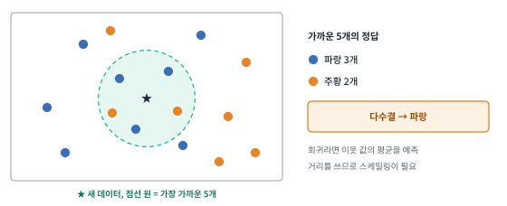{#fig-w11-knn width=100% fig-alt="별 모양의 새 데이터를 중심으로 점선 원 안에 가장 가까운 다섯 개 점이 있고, 파랑 셋과 주황 둘이므로 다수결로 파랑이 된다."}

k가 작으면 가까운 점 하나의 잡음에도 예측이 흔들리고, k가 크면 경계가 지나치게 뭉개집니다. 거리를 쓰므로 단위가 큰 열이 거리를 좌우하지 않도록 스케일링이 필요합니다. 예측할 때마다 모든 학습 데이터와 거리를 계산하므로 데이터가 많으면 느리고, 특성이 많아지면 모든 점이 비슷하게 멀어져 성능이 떨어집니다. 원리가 단순해 기준 모델이나 추천·유사 사례 검색에 씁니다.

```python
from sklearn.neighbors import KNeighborsClassifier
model = make_pipeline(StandardScaler(), KNeighborsClassifier(n_neighbors=5)).fit(X_train, y_train)
```

## 나이브 베이즈 {#sec-w11t-nb}

나이브 베이즈는 베이즈 정리로 클래스별 확률을 계산합니다. 클래스가 주어지면 특성들이 서로 독립이라고 가정하므로 계산이 간단합니다.

$$
P(y\mid x_1,\dots,x_p)\ \propto\ P(y)\prod_{j=1}^{p}P(x_j\mid y)
$$

스팸 분류라면 "무료", "당첨" 같은 단어가 스팸 메일과 정상 메일에서 각각 얼마나 자주 나오는지 세어 두고, 새 메일에 나온 단어들의 확률을 곱해 더 큰 쪽을 고릅니다. 학습과 예측이 매우 빠르고 데이터가 적어도 동작해 문서 분류의 기준 모델로 많이 씁니다. 독립 가정은 현실에서 대부분 깨지므로 계산된 확률값 자체는 믿기 어렵습니다.

```python
from sklearn.feature_extraction.text import TfidfVectorizer
from sklearn.naive_bayes import MultinomialNB
model = make_pipeline(TfidfVectorizer(), MultinomialNB()).fit(texts_train, labels_train)    # 문장 목록과 라벨
```

## 트리 기반 모델 {#sec-w11t-tree}

### 의사결정나무

의사결정나무는 "주말인가?", "강수량이 5mm 이상인가?" 같은 질문으로 데이터를 반복해서 나눕니다(@fig-w11-tree). 맨 위의 뿌리 노드에서 시작해 질문에 따라 가지를 내려가고, 더 나누지 않는 잎 노드에서 예측합니다. 분류 트리는 잎에 모인 학습 사례의 다수 클래스를, 회귀 트리는 평균을 예측합니다.

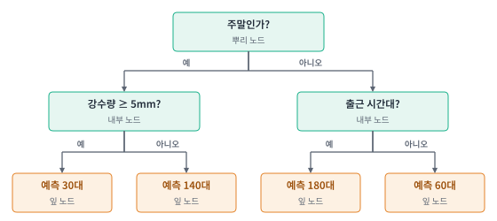{#fig-w11-tree width=100% fig-alt="뿌리 노드 주말인가에서 예와 아니오로 나뉘고, 다시 강수량 5mm 이상인가와 출근 시간대인가로 나뉜 뒤 네 잎 노드가 30대, 140대, 180대, 60대를 예측한다."}

어떤 질문으로 나눌지는 나눈 뒤의 데이터가 얼마나 순수해지는지로 정합니다. 분류에서는 지니 불순도를 많이 씁니다. 클래스 $k$의 비율을 $p_k$라 하면

$$
G = 1-\sum_k p_k^2
$$

이고, 한 클래스만 있으면 0, 두 클래스가 반반이면 0.5입니다. 모든 특성과 기준값 후보 중에서 불순도를 가장 많이 줄이는 질문을 고르며, 회귀 트리는 분산(제곱오차)을 가장 많이 줄이는 질문을 고릅니다.

트리는 규칙을 그대로 읽을 수 있고, 비선형 관계와 상호작용을 자동으로 잡으며, 스케일링이 필요 없습니다. 대신 깊게 키우면 학습 데이터를 외우고, 데이터가 조금만 바뀌어도 트리 모양이 크게 달라집니다. 최대 깊이와 잎의 최소 사례 수로 크기를 제한합니다. 단일 트리의 이런 불안정함을 여러 트리로 보완한 것이 다음의 두 앙상블입니다.

```python
from sklearn.tree import DecisionTreeClassifier, export_text
model = DecisionTreeClassifier(max_depth=3, min_samples_leaf=20).fit(X_train, y_train)
print(export_text(model))    # 학습된 질문 규칙을 글로 출력
```

### 랜덤 포레스트

랜덤 포레스트는 서로 조금씩 다른 트리를 많이 만들어 예측을 모읍니다(@fig-w11-forest). 학습 데이터에서 같은 크기의 표본을 복원추출(부트스트랩)해 트리마다 다른 데이터를 주고, 각 분할에서도 특성의 일부만 무작위로 후보로 씁니다. 분류는 트리들의 투표나 확률 평균으로, 회귀는 평균으로 예측합니다.

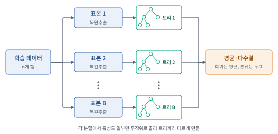{#fig-w11-forest width=100% fig-alt="학습 데이터에서 표본 1부터 B까지 복원추출하고, 각 표본으로 트리를 학습한 뒤 모든 트리의 예측을 평균·다수결로 모은다."}

트리 하나하나는 과적합되어 있어도, 서로 다른 실수를 하는 트리를 평균하면 실수가 상쇄되어 예측이 안정됩니다. 트리 수를 늘려도 과적합이 심해지지 않는 편이어서 설정을 크게 손대지 않아도 성능이 괜찮게 나옵니다. 트리 수, 최대 깊이, 분할마다 고려할 특성 수가 주요 설정입니다. 모델이 크고 단일 트리처럼 규칙을 읽을 수는 없습니다. 특성 중요도는 예측에 기여한 정도를 보여 줄 뿐 인과 관계를 뜻하지 않습니다.

```python
from sklearn.ensemble import RandomForestClassifier
model = RandomForestClassifier(n_estimators=300, max_features="sqrt", random_state=42).fit(X_train, y_train)
print(model.feature_importances_)    # 특성 중요도
```

### 그래디언트 부스팅

부스팅은 트리를 동시에 만들지 않고 하나씩 차례로 추가합니다(@fig-w11-boost). 첫 트리가 정답을 학습하고, 다음 트리는 지금까지의 예측이 틀린 만큼, 즉 남은 오차를 학습합니다. 이를 반복해 트리들의 출력을 더한 것이 최종 예측입니다.

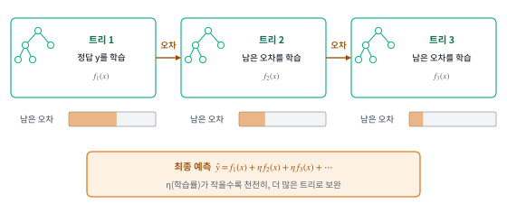{#fig-w11-boost width=100% fig-alt="트리 1이 정답을 학습하고 트리 2와 트리 3이 차례로 남은 오차를 학습하면서 남은 오차 막대가 줄어든다. 최종 예측은 각 트리 출력에 학습률을 곱해 더한 값이다."}

"남은 오차"를 일반화한 것이 손실 함수의 기울기이며, 그래서 그래디언트 부스팅이라고 부릅니다. 각 트리의 출력에는 학습률 $\eta$를 곱해 조금씩만 반영합니다. 학습률이 작으면 트리가 더 많이 필요하지만 대개 더 좋은 결과를 냅니다. 트리 수를 계속 늘리면 학습 데이터에 과적합되므로 검증 점수가 더 오르지 않을 때 멈추는 조기 종료를 함께 씁니다.

| 구분 | 단일 트리 | 랜덤 포레스트 | 그래디언트 부스팅 |
|---|---|---|---|
| 트리를 만드는 방식 | 하나 | 서로 독립적으로 여러 개 | 앞선 트리의 오차를 보며 차례로 |
| 결합 | 없음 | 평균·투표 | 학습률을 곱해 합산 |
| 주로 줄이는 것 | — | 예측의 흔들림(분산) | 남은 오차(편향) |
| 주요 설정 | 깊이, 잎 크기 | 트리 수, 특성 추출 수 | 학습률, 트리 수, 깊이, 조기 종료 |

: 트리 기반 모델의 비교 {#tbl-w11-trees}

표 데이터의 분류·회귀에서 그래디언트 부스팅은 성능이 좋은 경우가 많아 가장 먼저 시도해 볼 만한 모델입니다. 구현 도구로 XGBoost, LightGBM, CatBoost가 널리 쓰입니다. XGBoost는 규제를 포함한 효율적인 부스팅 구현이고, LightGBM은 큰 데이터에서 학습이 빠르며, CatBoost는 범주형 특성을 별도 인코딩 없이 다룰 수 있습니다.

```python
from sklearn.ensemble import HistGradientBoostingClassifier
model = HistGradientBoostingClassifier(learning_rate=0.05, max_iter=500, early_stopping=True).fit(X_train, y_train)
# XGBoost의 XGBClassifier(n_estimators=500, learning_rate=0.05, max_depth=4)도 같은 fit·predict로 사용
```

## 비지도 학습 모델 {#sec-w11t-unsup}

정답이 없는 데이터에서도 구조를 찾을 수 있습니다. 프로젝트에서는 데이터를 이해하거나, 특성을 줄이거나, 이상한 사례를 걸러 낼 때 씁니다(@fig-w11-unsup).

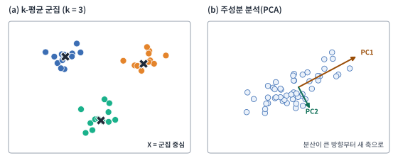{#fig-w11-unsup width=100% fig-alt="왼쪽은 세 색의 점 무리와 각 무리의 중심 X 표시, 오른쪽은 비스듬히 퍼진 점 구름과 가장 긴 방향의 PC1 화살표, 그에 수직인 PC2 화살표."}

**k-평균 군집**은 데이터를 k개의 무리로 나눕니다. 중심 k개를 임의로 정한 뒤, 각 점을 가장 가까운 중심에 배정하고 배정된 점들의 평균으로 중심을 옮기는 일을 중심이 거의 움직이지 않을 때까지 반복합니다. k는 사람이 정해야 하고, 거리를 쓰므로 스케일링이 필요합니다. 고객 세분화처럼 비슷한 사례를 묶을 때 씁니다.

```python
from sklearn.cluster import KMeans
clusters = KMeans(n_clusters=3, n_init="auto", random_state=0).fit_predict(X_scaled)
```

**주성분 분석(PCA)**은 데이터가 가장 넓게 퍼진 방향을 첫 번째 축(PC1)으로, 그와 수직이면서 다음으로 넓게 퍼진 방향을 두 번째 축(PC2)으로 삼습니다. 특성이 수십 개일 때 앞의 몇 개 주성분만 남겨 차원을 줄이거나, 2차원으로 줄여 데이터를 그림으로 볼 때 씁니다.

```python
from sklearn.decomposition import PCA
X_2d = PCA(n_components=2).fit_transform(X_scaled)
```

**이상 탐지**는 대부분의 데이터와 다른 사례를 찾습니다. Isolation Forest는 무작위 분할을 반복했을 때 적은 횟수 만에 홀로 떨어지는 사례일수록 이상하다고 봅니다. 라벨링 전에 입력 오류를 걸러 내거나, 정답 데이터가 거의 없는 고장·부정 사용 탐지에 씁니다.

```python
from sklearn.ensemble import IsolationForest
flag = IsolationForest(random_state=0).fit_predict(X)    # -1이면 이상, 1이면 정상
```

## 신경망의 학습 원리 {#sec-w11t-nn}

신경망의 기본 단위인 뉴런은 로지스틱 회귀와 같은 구조입니다. 입력의 가중합을 계산하고 비선형 함수인 **활성화 함수**를 거쳐 출력합니다. 이런 뉴런을 여러 개 나란히 놓은 것이 층이고, 층을 여러 겹 쌓은 것이 깊은 신경망입니다.

| 활성화 함수 | 식 | 출력 범위 | 주로 쓰는 곳 |
|---|---|---|---|
| ReLU | $\max(0, z)$ | 0 이상 | 은닉층의 기본값 |
| 시그모이드 | $1/(1+e^{-z})$ | 0~1 | 이진 분류의 출력층 |
| tanh | $(e^{z}-e^{-z})/(e^{z}+e^{-z})$ | −1~1 | 순환 신경망 내부 |
| 소프트맥스 | $e^{z_k}/\sum_m e^{z_m}$ | 합이 1인 확률들 | 다중 분류의 출력층 |

: 대표 활성화 함수 {#tbl-w11-activation}

활성화 함수가 없으면 층을 아무리 쌓아도 전체가 하나의 선형 변환으로 합쳐집니다. 비선형 활성화 덕분에 층을 쌓을수록 복잡한 관계를 표현할 수 있습니다.

신경망은 다음 과정을 반복해 학습합니다(@fig-w11-trainloop). 학습 데이터의 일부(미니배치)를 넣어 예측값을 계산하는 **순전파**, 예측과 정답의 차이를 **손실**로 계산하는 단계, 손실을 줄이려면 각 가중치를 어느 방향으로 바꿔야 하는지 기울기를 거꾸로 계산하는 **역전파**, 그 기울기로 가중치를 조금 고치는 **갱신**입니다.

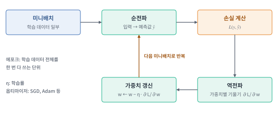{#fig-w11-trainloop width=100% fig-alt="미니배치가 순전파로 예측값이 되고, 손실을 계산한 뒤 역전파로 기울기를 구해 가중치를 갱신하고, 다음 미니배치로 반복한다."}

$$
w \leftarrow w - \eta\,\frac{\partial L}{\partial w}
$$

학습률 $\eta$는 한 번에 고치는 크기입니다. 너무 크면 손실이 줄지 않고 튀고, 너무 작으면 학습이 지나치게 느립니다. 학습 데이터 전체를 한 번 다 쓰는 단위를 **에포크**, 한 번에 넣는 사례 수를 **배치 크기**라고 합니다. 가중치를 고치는 규칙을 옵티마이저라고 하며, 기본형인 SGD와 가중치마다 갱신 크기를 자동으로 조절하는 Adam이 많이 쓰입니다.

손실 함수는 문제에 따라 고릅니다. 회귀에는 평균제곱오차(MSE)를, 분류에는 교차엔트로피를 씁니다. 교차엔트로피는 정답 클래스에 준 확률 $p_{\text{정답}}$로 $L=-\log p_{\text{정답}}$을 계산하므로, 정답에 낮은 확률을 줄수록 손실이 커집니다. 손실 함수는 학습을 이끄는 기준이고 평가 지표는 목적에 맞는 성능을 판단하는 기준이므로 둘이 꼭 같을 필요는 없습니다.

신경망은 파라미터가 많아 과적합되기 쉽습니다. 학습 중에 일부 뉴런을 무작위로 끄는 **드롭아웃**, 가중치가 커지지 않게 벌점을 주는 **가중치 감쇠**, 검증 손실이 더 줄지 않으면 멈추는 **조기 종료**, 층의 출력 분포를 고르게 맞춰 학습을 안정시키는 **배치 정규화**를 함께 씁니다.

```python
optimizer = torch.optim.Adam(model.parameters(), lr=1e-3)
loss = loss_fn(model(xb), yb)              # 순전파와 손실 계산
loss.backward()                            # 역전파: 기울기 계산
optimizer.step(); optimizer.zero_grad()    # 가중치 갱신, 기울기 초기화
```

## 다층 퍼셉트론 {#sec-w11t-mlp}

다층 퍼셉트론(MLP)은 입력층, 하나 이상의 은닉층, 출력층으로 이루어진 신경망입니다(@fig-w11-mlp). 앞 층의 모든 뉴런이 다음 층의 모든 뉴런과 연결되므로 완전연결 신경망이라고도 합니다. 각 은닉층은 가중합을 계산하고 ReLU를 적용하며, 출력층은 문제에 맞게 구성합니다.

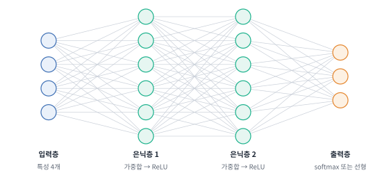{#fig-w11-mlp width=100% fig-alt="입력층 4개 노드, 은닉층 6개 노드 두 층, 출력층 3개 노드가 층 사이에서 모두 연결되어 있다."}

그림의 신경망이 가진 파라미터 수는 층마다 (입력 수 × 출력 수 + 출력 수)를 더해 구합니다. (4×6+6) + (6×6+6) + (6×3+3) = 30 + 42 + 21 = 93개입니다. 층이 넓고 깊어질수록 파라미터가 빠르게 늘어나므로 그만큼 많은 데이터가 필요합니다.

```python
import torch.nn as nn
model = nn.Sequential(nn.Linear(4, 6), nn.ReLU(), nn.Linear(6, 6), nn.ReLU(), nn.Linear(6, 3))
print(sum(p.numel() for p in model.parameters()))    # 93
```

| 문제 | 출력층 | 손실 함수 |
|---|---|---|
| 회귀 | 뉴런 1개, 활성화 없음(선형) | 평균제곱오차 |
| 이진 분류 | 뉴런 1개, 시그모이드 | 이진 교차엔트로피 |
| 다중 분류 | 클래스 수만큼, 소프트맥스 | 교차엔트로피 |
| 다중 라벨 분류 | 라벨 수만큼, 각각 시그모이드 | 라벨별 이진 교차엔트로피 |

: 문제 유형에 따른 출력층 구성 {#tbl-w11-outputs}

MLP는 표 데이터에도 쓸 수 있지만, 표 데이터에서는 그래디언트 부스팅이 더 적은 노력으로 비슷하거나 나은 성능을 내는 경우가 많습니다. 입력 스케일링이 필요하고, 이미지처럼 위치 구조가 중요한 데이터를 한 줄로 펼쳐 넣으면 그 구조를 활용하지 못합니다. 그 한계를 해결한 것이 다음의 합성곱 신경망입니다.

## 합성곱 신경망 {#sec-w11t-cnn}

### 합성곱 연산

합성곱 신경망(CNN)은 이미지 전체를 한꺼번에 보지 않고, 작은 **필터**(커널)를 이미지 위에서 한 칸씩 옮기며 지역 패턴을 찾습니다(@fig-w11-conv). 필터가 놓인 영역의 값과 필터 값을 칸끼리 곱해 모두 더한 값이 출력 한 칸이 되며, 이렇게 만든 출력을 **특성 맵**이라고 합니다.

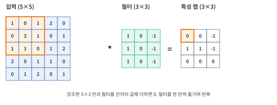{#fig-w11-conv width=100% fig-alt="5×5 입력의 왼쪽 위 3×3 영역이 강조되어 있고, 3×3 필터와 곱해 더한 값이 3×3 특성 맵의 왼쪽 위 칸이 된다."}

같은 필터를 이미지의 모든 위치에 쓰므로(가중치 공유) 고양이가 왼쪽에 있든 오른쪽에 있든 같은 패턴을 찾을 수 있고, 파라미터 수도 크게 줄어듭니다. 필터의 값은 사람이 정하지 않고 학습으로 정해집니다. 출력 크기는 입력 크기 $W$, 필터 크기 $K$, 가장자리 채움 $P$, 이동 간격(stride) $S$로 정해집니다.

$$
\text{출력 크기} = \frac{W - K + 2P}{S} + 1
$$

그림처럼 $W=5$, $K=3$, $P=0$, $S=1$이면 출력은 3입니다. 가장자리를 한 칸씩 채우면($P=1$) 출력이 입력과 같은 5가 됩니다. 컬러 이미지는 빨강·초록·파랑 3개 채널이므로 필터도 3×3×3 크기이고, 필터를 16개 쓰면 특성 맵 16장이 나옵니다. 이 층의 파라미터는 3×3×3×16 + 16(편향) = 448개입니다.

### CNN의 구조

CNN은 합성곱과 ReLU로 특성 맵을 만들고, **풀링**으로 특성 맵의 크기를 줄이는 과정을 여러 번 반복합니다(@fig-w11-cnn). 최대 풀링은 2×2 영역에서 가장 큰 값만 남겨 가로·세로를 절반으로 줄입니다. 앞쪽 층은 선이나 모서리 같은 단순한 패턴을, 뒤쪽 층은 그것들이 조합된 눈·바퀴 같은 복잡한 패턴을 찾습니다. 마지막에는 특성 맵을 한 줄로 펼쳐(평탄화) 완전연결층과 출력층으로 클래스를 예측합니다.

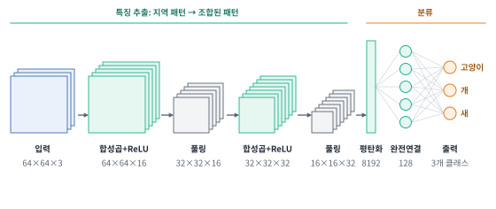{#fig-w11-cnn width=100% fig-alt="64×64×3 입력이 합성곱으로 64×64×16, 풀링으로 32×32×16, 합성곱으로 32×32×32, 풀링으로 16×16×32가 되고, 평탄화해 8192개 값이 된 뒤 완전연결층 128개를 거쳐 고양이, 개, 새 세 클래스를 출력한다."}

그림의 마지막 특성 맵은 16×16×32이므로 평탄화하면 8,192개의 값이 됩니다. 이미지 라벨링에서 만든 데이터는 CNN의 입력과 정답이 됩니다. 이미지 전체에 붙인 범주는 분류 모델의 정답이 되고, 사각형 좌표는 검출 모델의, 다각형을 변환한 마스크는 분할 모델의 정답이 됩니다.

```python
model = nn.Sequential(
    nn.Conv2d(3, 16, 3, padding=1), nn.ReLU(), nn.MaxPool2d(2),     # 64×64×16 → 32×32×16
    nn.Conv2d(16, 32, 3, padding=1), nn.ReLU(), nn.MaxPool2d(2),    # 32×32×32 → 16×16×32
    nn.Flatten(), nn.Linear(8192, 128), nn.ReLU(), nn.Linear(128, 3))
```

### 대표 CNN 구조

층을 깊게 쌓으면 표현력은 늘지만 기울기가 앞쪽 층까지 잘 전달되지 않아 학습이 어려워집니다. ResNet은 층의 입력을 출력에 그대로 더하는 **잔차 연결**로 이 문제를 줄여 수십~수백 층 신경망의 학습을 가능하게 했습니다. 프로젝트에서는 직접 설계하기보다 이런 검증된 구조를 가져다 씁니다.

| 과제 | 대표 구조 | 핵심 아이디어 | 정답 데이터 |
|---|---|---|---|
| 이미지 분류 | ResNet, EfficientNet | 잔차 연결, 깊이·너비·해상도의 균형 | 이미지별 범주 |
| 객체 검출 | YOLO | 이미지를 한 번 통과시켜 상자와 클래스를 동시에 예측 | 상자 좌표와 클래스 |
| 객체 검출 | Faster R-CNN | 후보 영역을 먼저 찾고 영역마다 분류 | 상자 좌표와 클래스 |
| 의미 분할 | U-Net | 줄였던 특성 맵을 다시 키우며 앞쪽 층의 세부 정보를 이어 붙임 | 픽셀별 마스크 |
| 인스턴스 분할 | Mask R-CNN | 검출한 객체마다 마스크 예측 | 객체별 마스크 |

: 대표 CNN 구조와 필요한 정답 데이터 {#tbl-w11-cnnmodels}

CNN은 1차원으로도 씁니다. 센서 신호나 음성처럼 시간 축을 따라 지역 패턴이 있는 데이터에 1차원 필터를 적용합니다.

```python
from ultralytics import YOLO
YOLO("yolov8n.pt").train(data="data.yaml", epochs=50)    # 사전학습 YOLO를 내 상자 라벨로 미세조정
```

## 순환 신경망 {#sec-w11t-rnn}

순환 신경망(RNN)은 문장이나 시계열처럼 순서가 있는 데이터를 한 시점씩 처리합니다(@fig-w11-rnn). 각 시점에서 현재 입력 $x_t$와 직전 시점의 상태 $h_{t-1}$을 함께 받아 새 상태 $h_t$를 계산하고, 그 상태를 다음 시점으로 넘깁니다. 상태 $h_t$는 지금까지 본 입력을 요약한 기억 역할을 합니다.

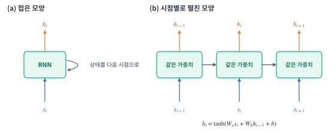{#fig-w11-rnn width=100% fig-alt="왼쪽은 입력 x_t를 받아 h_t를 내고 상태를 자신에게 되돌리는 RNN 셀, 오른쪽은 t−1, t, t+1 세 시점의 셀이 가로로 이어져 상태를 넘기는 모습과 h_t = tanh(W_x x_t + W_h h_{t−1} + b) 식."}

$$
h_t=\tanh(W_xx_t+W_hh_{t-1}+b)
$$

모든 시점에서 같은 가중치 $W_x$, $W_h$를 쓰므로 길이가 다른 시퀀스도 처리할 수 있습니다. 문장 분류라면 마지막 상태로 클래스를 예측하고, 시계열 예측이라면 각 시점의 상태로 다음 값을 예측합니다.

```python
rnn = nn.RNN(input_size=8, hidden_size=32, batch_first=True)
out, h = rnn(x)    # x: (사례 수, 시점 수, 8) → out: 시점별 상태, h: 마지막 상태
```

기본 RNN은 시퀀스가 길어지면 역전파할 때 기울기가 시점마다 거듭 곱해져 0에 가까워지거나(기울기 소실) 지나치게 커집니다(기울기 폭주). 그래서 멀리 떨어진 앞부분의 정보를 학습하기 어렵습니다. 또 앞 시점이 끝나야 다음 시점을 계산할 수 있어 여러 위치를 병렬로 계산하지 못합니다.

## LSTM과 GRU {#sec-w11t-lstm}

LSTM은 RNN의 기울기 소실 문제를 줄이도록 설계한 순환 신경망입니다. 상태와 별도로 **셀 상태** $C_t$라는 통로를 두고, 세 개의 **게이트**로 정보를 얼마나 지우고 더하고 내보낼지를 학습합니다(@fig-w11-lstm). 게이트는 시그모이드로 0~1 값을 내어, 0이면 막고 1이면 그대로 통과시키는 밸브처럼 동작합니다.

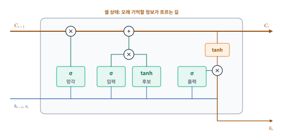{#fig-w11-lstm width=100% fig-alt="셀 상태 C_{t−1}이 위쪽 선을 따라 망각 게이트와 곱해지고, 입력 게이트와 후보 값의 곱이 더해져 C_t가 된다. 출력 게이트와 tanh(C_t)를 곱해 h_t를 낸다. 아래쪽으로 h_{t−1}과 x_t가 네 게이트에 들어간다."}

| 구성 요소 | 하는 일 |
|---|---|
| 망각 게이트 $f_t$ | 이전 셀 상태에서 무엇을 지울지 정함 |
| 입력 게이트 $i_t$ | 새 후보 정보 중 무엇을 셀 상태에 더할지 정함 |
| 후보 값 $\tilde C_t$ | tanh로 만든 새 정보 |
| 셀 상태 $C_t = f_t \odot C_{t-1} + i_t \odot \tilde C_t$ | 오래 기억할 정보 |
| 출력 게이트 $o_t$ | 셀 상태 중 무엇을 이번 출력 $h_t = o_t \odot \tanh(C_t)$로 내보낼지 정함 |

: LSTM의 구성 요소 ($\odot$은 원소별 곱) {#tbl-w11-lstm}

셀 상태는 곱하기와 더하기만 거쳐 다음 시점으로 넘어가므로 기울기가 여러 시점을 지나도 잘 사라지지 않습니다. GRU는 LSTM을 단순화한 구조로, 셀 상태를 따로 두지 않고 업데이트 게이트와 리셋 게이트 두 개만 씁니다. 파라미터가 적어 학습이 빠르고 성능은 비슷한 경우가 많아 둘 다 비교 후보로 둡니다.

```python
lstm = nn.LSTM(input_size=8, hidden_size=32, num_layers=2, batch_first=True)
out, (h, c) = lstm(x)    # GRU는 nn.GRU(...)로 만들고 out, h = gru(x)
```

LSTM과 GRU는 시계열 예측, 센서 이상 탐지, 짧은 문장 분류에 씁니다. 입력 시퀀스 길이, 은닉 상태의 크기, 층 수가 주요 설정입니다. 다만 긴 문맥을 완벽하게 기억하지는 못하며, 시계열 문제에서는 과거값 특성을 만든 그래디언트 부스팅이 더 나은 경우도 많으므로 반드시 비교합니다. 긴 문맥과 병렬 계산이 필요한 언어 처리에서는 트랜스포머가 순환 신경망을 대부분 대신하게 되었습니다.

## 트랜스포머 {#sec-w11t-transformer}

트랜스포머는 순서대로 하나씩 처리하지 않고, **어텐션**으로 시퀀스의 모든 위치가 서로를 직접 참고하게 하는 구조입니다(@fig-w11-transformer). 입력 토큰을 벡터로 바꾸는 임베딩에 위치 정보를 더하고, 셀프 어텐션과 피드포워드 신경망으로 이루어진 블록을 여러 번 쌓은 뒤 출력층으로 예측합니다.

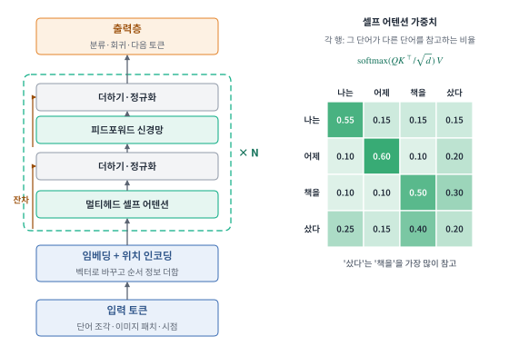{#fig-w11-transformer width=100% fig-alt="입력 토큰이 임베딩과 위치 인코딩을 거쳐, 멀티헤드 셀프 어텐션, 더하기·정규화, 피드포워드 신경망, 더하기·정규화로 이루어진 블록을 N번 지난 뒤 출력층으로 간다. 오른쪽은 나는, 어제, 책을, 샀다 네 단어 사이의 어텐션 가중치 표."}

### 셀프 어텐션

셀프 어텐션은 각 단어가 문장의 다른 단어들을 얼마나 참고할지를 계산합니다. 단어마다 세 벡터를 만듭니다. 찾고 싶은 정보를 나타내는 **쿼리**(Q), 자신이 가진 정보를 알리는 **키**(K), 실제로 전달할 내용인 **값**(V)입니다. 한 단어의 쿼리와 모든 단어의 키를 내적해 관련도를 구하고, 소프트맥스로 합이 1인 가중치로 바꾼 뒤, 그 가중치로 값들을 가중합합니다.

$$
\mathrm{Attention}(Q,K,V)=\mathrm{softmax}\!\left(\frac{QK^{\top}}{\sqrt{d_k}}\right)V
$$

$d_k$는 키 벡터의 차원이며, $\sqrt{d_k}$로 나누는 것은 내적 값이 너무 커져 소프트맥스가 한쪽으로 쏠리는 것을 막기 위해서입니다. 그림의 예에서 '샀다'는 무엇을 샀는지 알려 주는 '책을'에 가장 큰 가중치를 줍니다. 이 계산을 서로 다른 Q·K·V 가중치로 여러 번 나란히 하는 것이 **멀티헤드 어텐션**이며, 헤드마다 문법 관계, 지시 관계처럼 다른 종류의 관계를 잡습니다.

어텐션은 위치와 상관없이 모든 단어를 똑같이 바라보므로 그 자체로는 순서를 모릅니다. 그래서 임베딩에 **위치 인코딩**을 더해 순서 정보를 넣습니다. 블록마다 붙는 잔차 연결과 정규화는 깊게 쌓아도 학습이 안정되게 합니다.

```python
layer = nn.TransformerEncoderLayer(d_model=128, nhead=4, batch_first=True)
encoder = nn.TransformerEncoder(layer, num_layers=2)    # 블록 N = 2
out = encoder(x)    # x: (사례 수, 토큰 수, 128)
```

### 트랜스포머의 세 가지 형태

| 형태 | 특징 | 대표 모델 | 주된 과제 |
|---|---|---|---|
| 인코더 | 모든 단어가 앞뒤 문맥을 함께 봄 | BERT | 문장 분류, 개체명 인식, 문장 유사도 |
| 디코더 | 앞쪽 단어만 보고 다음 단어를 예측(미래를 가리는 마스크 사용) | GPT 계열 | 문장 생성, 대화 |
| 인코더–디코더 | 입력을 인코더로 읽고 디코더로 새 시퀀스를 생성 | T5 | 번역, 요약 |

: 트랜스포머의 세 가지 형태 {#tbl-w11-transformers}

트랜스포머는 모든 위치를 동시에 계산하므로 학습을 병렬로 빠르게 할 수 있고, 멀리 떨어진 단어 사이의 관계도 한 번에 연결합니다. 대신 모든 단어 쌍의 관련도를 계산하므로 시퀀스 길이가 두 배가 되면 계산량과 메모리는 약 네 배로 늘어납니다. 언어 외에도 이미지를 작은 조각(패치)으로 잘라 토큰처럼 다루는 ViT, 시계열을 다루는 모델 등으로 쓰임이 넓어졌습니다.

## 사전학습 모델과 전이학습 {#sec-w11t-transfer}

깊은 신경망을 처음부터 학습하려면 많은 라벨 데이터와 계산 자원이 필요합니다. 프로젝트에서는 대부분 대규모 데이터로 미리 학습된 **사전학습 모델**을 가져와 내 과제에 맞게 고쳐 씁니다. 이것을 **전이학습**이라고 합니다(@fig-w11-transfer).

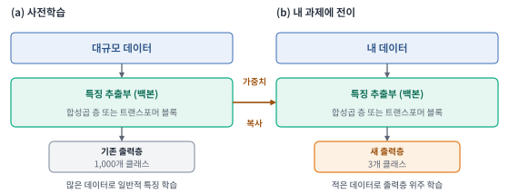{#fig-w11-transfer width=100% fig-alt="왼쪽은 대규모 데이터로 특징 추출부와 1,000개 클래스 출력층을 학습하고, 오른쪽은 같은 특징 추출부를 가져와 3개 클래스 새 출력층을 붙여 내 데이터로 학습한다."}

대규모 데이터로 학습한 특징 추출부(백본)는 선, 질감, 형태처럼 여러 과제에 두루 쓸 수 있는 특징을 이미 알고 있습니다. 이 부분은 가져오고 출력층만 내 클래스 수에 맞게 새로 붙입니다.

| 방법 | 하는 일 | 알맞은 상황 |
|---|---|---|
| 특징 추출 | 백본 가중치를 고정하고 새 출력층만 학습 | 데이터가 수백 장 수준으로 적을 때 |
| 미세조정 | 새 출력층을 학습한 뒤 백본 일부나 전체도 작은 학습률로 함께 학습 | 데이터가 어느 정도 있고 원래 데이터와 성격이 다를 때 |

: 전이학습의 두 가지 방법 {#tbl-w11-finetune}

사전학습 모델은 학습에 쓴 데이터와 같은 방식으로 입력을 준비해야 합니다. 이미지는 정해진 크기와 정규화 값을, 텍스트는 그 모델의 토크나이저를 그대로 써야 합니다. 한국어 문장이라면 한국어로 사전학습한 모델을 고릅니다. 사전학습 모델을 써도 내 데이터의 라벨 품질, 분할, 검증은 그대로 중요하며, 원래 학습 데이터에 담긴 편향이 결과에 이어질 수 있다는 점도 확인합니다. 모델마다 사용 허락 범위(라이선스)가 다르므로 프로젝트에 쓰기 전에 확인합니다.

```python
from transformers import AutoModelForSequenceClassification
model = AutoModelForSequenceClassification.from_pretrained("klue/bert-base", num_labels=2)    # 한국어 BERT로 이진 분류
```

```python
from torchvision import models
model = models.resnet18(weights="DEFAULT")                 # 사전학습 가중치
for p in model.parameters(): p.requires_grad = False       # 특징 추출: 백본 고정
model.fc = nn.Linear(model.fc.in_features, 3)              # 새 출력층(학습 대상)
```

## 모델 선택 {#sec-w11t-select}

### 데이터 유형에 따른 후보

모델은 데이터의 종류에서 먼저 후보가 좁혀집니다. 단순한 모델로 기준을 세운 뒤 더 강한 후보로 넘어가는 순서가 안전합니다.

| 데이터 | 문제 | 먼저 해 볼 모델 | 다음 후보 | 대표 도구 |
|---|---|---|---|---|
| 표 | 회귀·분류 | 평균·최빈값 기준, 선형·로지스틱 회귀 | 랜덤 포레스트, 그래디언트 부스팅 | scikit-learn, XGBoost, LightGBM |
| 이미지 | 분류 | 사전학습 CNN의 특징 추출 | 미세조정(ResNet, EfficientNet, ViT) | PyTorch, TensorFlow |
| 이미지 | 검출·분할 | 사전학습 YOLO 미세조정 | Faster R-CNN, U-Net, Mask R-CNN | PyTorch 기반 검출 도구 |
| 텍스트 | 분류 | 단어 빈도(TF-IDF) + 로지스틱 회귀·나이브 베이즈 | 사전학습 BERT 계열 미세조정 | scikit-learn, Hugging Face Transformers |
| 시계열 | 예측 | 직전 값·같은 시각 평균 기준, 시차 특성 + 부스팅 | LSTM·GRU, 트랜스포머 | scikit-learn, PyTorch |
| 정답 없음 | 묶기·이상 찾기 | k-평균, PCA | Isolation Forest | scikit-learn |

: 데이터 유형별 모델 후보 {#tbl-w11-candidates}

### 고를 때 따져 볼 조건

| 조건 | 판단 |
|---|---|
| 데이터 양 | 수백~수천 건이면 단순 모델이나 사전학습 모델의 특징 추출, 많을수록 복잡한 모델을 시도 |
| 해석의 필요 | 결정 이유를 설명해야 하면 선형 모델이나 얕은 트리를 기준으로 둠 |
| 계산 자원 | GPU가 없으면 표 데이터는 트리 앙상블, 이미지·텍스트는 작은 사전학습 모델 |
| 예측 속도 | 실시간 응답이 필요하면 모델 크기와 예측 시간도 지표로 기록 |
| 오류 비용 | 놓치는 것이 비싼지 잘못 경보하는 것이 비싼지에 따라 지표와 임곗값을 정함 |

: 모델 선택의 조건 {#tbl-w11-criteria}

### 모델별 특성 정리

| 모델 | 문제 | 스케일링 | 주요 하이퍼파라미터 | 장점 | 주의점 |
|---|---|---|---|---|---|
| 선형회귀 | 회귀 | 필요(규제 시) | 규제 세기 | 빠르고 해석 쉬움 | 비선형 관계 표현 못 함 |
| 로지스틱 회귀 | 분류 | 필요 | 규제 세기 C | 확률 출력, 해석 쉬움 | 경계가 직선 |
| SVM | 분류·회귀 | 필수 | C, 커널, gamma | 중간 규모에서 정확 | 큰 데이터에서 느림 |
| k-NN | 분류·회귀 | 필수 | k, 거리 | 단순, 학습 없음 | 예측 느림, 특성 많으면 약함 |
| 나이브 베이즈 | 분류 | 불필요 | 평활화 값 | 매우 빠름, 적은 데이터 | 확률값 신뢰 낮음 |
| 의사결정나무 | 분류·회귀 | 불필요 | 깊이, 잎 크기 | 규칙을 읽을 수 있음 | 과적합, 불안정 |
| 랜덤 포레스트 | 분류·회귀 | 불필요 | 트리 수, 특성 수 | 설정 없이도 안정적 | 모델이 큼 |
| 그래디언트 부스팅 | 분류·회귀 | 불필요 | 학습률, 트리 수, 깊이 | 표 데이터에서 성능이 좋음 | 설정에 민감, 조기 종료 필요 |
| MLP | 분류·회귀 | 필수 | 층 수·너비, 학습률 | 유연함 | 표 데이터에선 부스팅보다 약한 경우 많음 |
| CNN | 이미지 | 정규화 | 구조, 학습률, 증강 | 위치 패턴 학습 | 데이터·계산 많이 필요 |
| LSTM·GRU | 시퀀스 | 필요 | 시퀀스 길이, 은닉 크기 | 순서 정보 활용 | 긴 문맥 한계, 병렬화 어려움 |
| 트랜스포머 | 텍스트·이미지·시계열 | 모델 규칙 따름 | 사전학습 모델 선택, 학습률 | 긴 문맥, 전이학습 | 계산·메모리 큼 |

: 모델별 특성 정리 {#tbl-w11-summary}

## 이미지·텍스트·시계열의 입력 준비 {#sec-w11t-inputs}

모델이 다루는 것은 결국 숫자 배열이므로, 데이터 종류마다 숫자로 바꾸는 방식이 정해져 있습니다.

| 데이터 | 모델에 넣는 모양 | 준비 과정 |
|---|---|---|
| 표 | (사례 수, 특성 수) | 결측 처리, 범주 인코딩, 스케일링 |
| 이미지 | (사례 수, 채널, 높이, 너비) | 크기 통일, 0~1 또는 정해진 평균·표준편차로 정규화, 학습 데이터에만 증강 |
| 텍스트 | (사례 수, 토큰 수) | 토크나이저로 토큰 ID 변환, 길이를 맞추는 자르기·채우기 |
| 시계열 | (사례 수, 시점 수, 특성 수) | 과거 일정 구간을 잘라 입력 창 만들기, 그다음 시점을 정답으로 |

: 데이터 종류별 입력 형태 {#tbl-w11-inputs}

이미지 증강은 뒤집기, 회전, 밝기 변화처럼 정답이 바뀌지 않는 변형으로 학습 데이터를 늘리는 방법입니다. 검증·테스트 데이터에는 적용하지 않습니다. 검출 데이터를 뒤집거나 자르면 상자 좌표도 똑같이 바꿔야 합니다. 시계열은 입력 창이 예측 시점 이후의 값을 포함하지 않는지 확인합니다.

## 머신러닝·딥러닝의 핵심 개념 {#sec-w11t-summary}

| 개념 | 설명 |
|---|---|
| 반복 학습 과정 | 문제 정의 → EDA → 분할 → 베이스라인 → 검증 데이터로 오류 분석·개선 반복 → 테스트로 최종 확인 |
| 데이터 누수 | 예측 시점에 알 수 없는 정보가 입력이나 변환 기준에 섞이는 것. 검증 점수를 부풀림 |
| 회귀·분류 지표 | 회귀는 MAE·RMSE·R², 분류는 혼동행렬에서 정밀도·재현율·F1. 불균형이면 정확도만 보지 않음 |
| 과적합과 규제 | 학습 점수는 높고 검증 점수는 낮은 상태. 모델마다 다른 규제 설정으로 억제 |
| 선형 모델 | 입력의 가중합. 로지스틱 회귀는 시그모이드로 확률을 만든 분류 모델 |
| SVM·k-NN | 마진을 최대로 하는 경계, 가까운 이웃의 다수결. 둘 다 스케일링 필요 |
| 트리 앙상블 | 랜덤 포레스트는 독립 트리의 평균, 부스팅은 오차를 차례로 보완. 표 데이터의 주력 모델 |
| 신경망 학습 | 순전파 → 손실 → 역전파 → 가중치 갱신의 반복. 학습률·에포크·배치 크기 |
| CNN | 필터를 옮기며 지역 패턴 추출, 합성곱과 풀링 반복. 이미지 분류·검출·분할 |
| RNN·LSTM | 상태를 다음 시점으로 전달. LSTM은 게이트와 셀 상태로 긴 의존성 완화 |
| 트랜스포머 | 셀프 어텐션으로 모든 위치를 직접 연결. 인코더·디코더·인코더–디코더 |
| 전이학습 | 사전학습 모델의 백본을 가져와 출력층을 바꾸고 내 데이터로 학습 |

: 머신러닝·딥러닝의 핵심 개념 {#tbl-w11-concepts}
